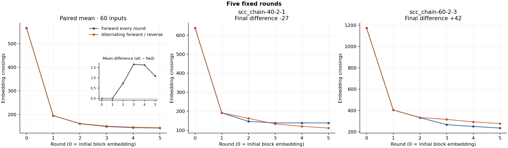
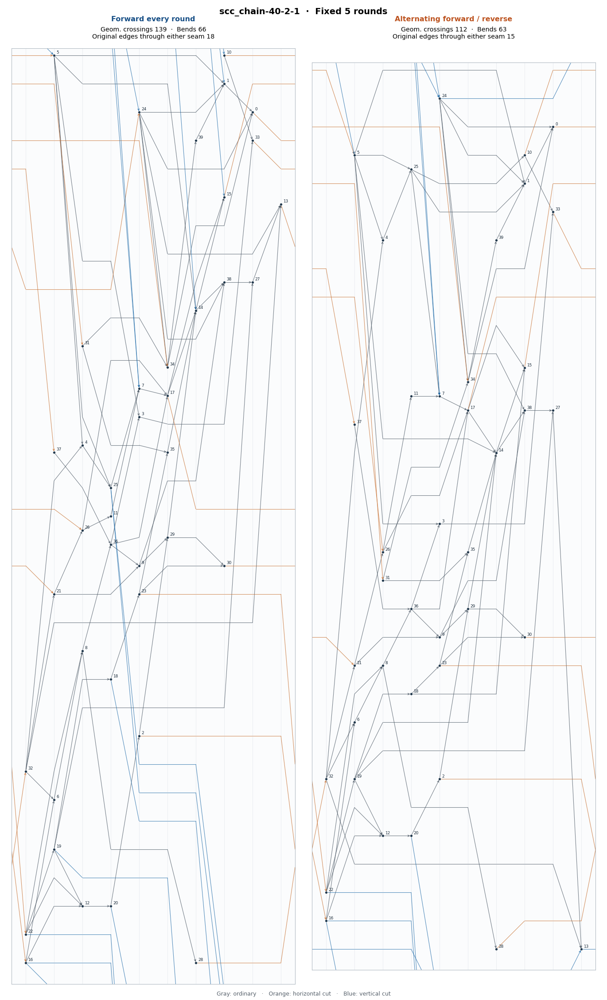
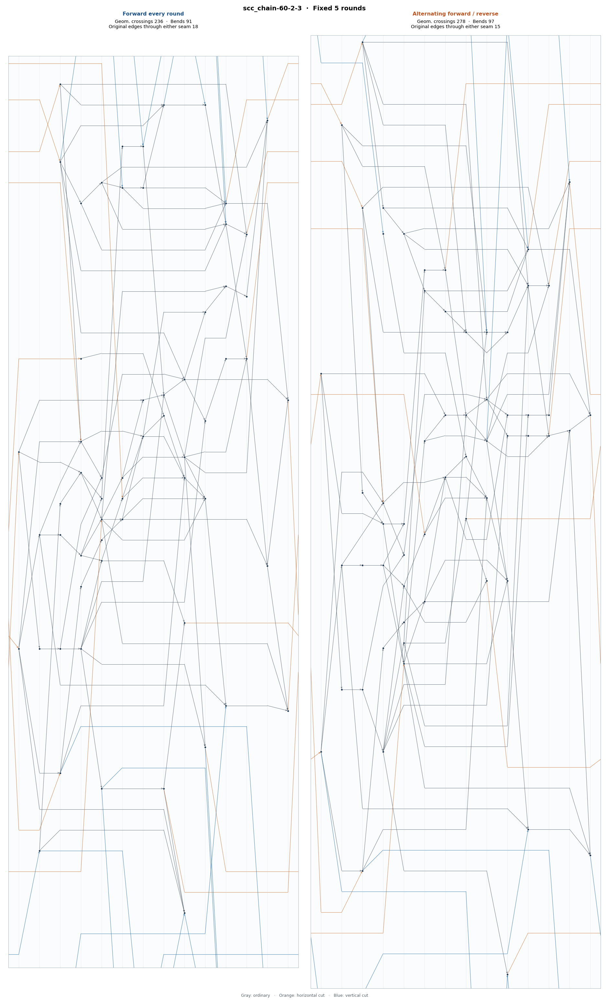
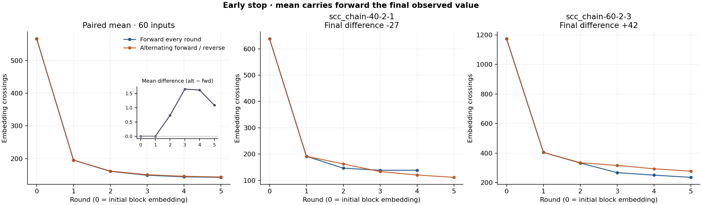
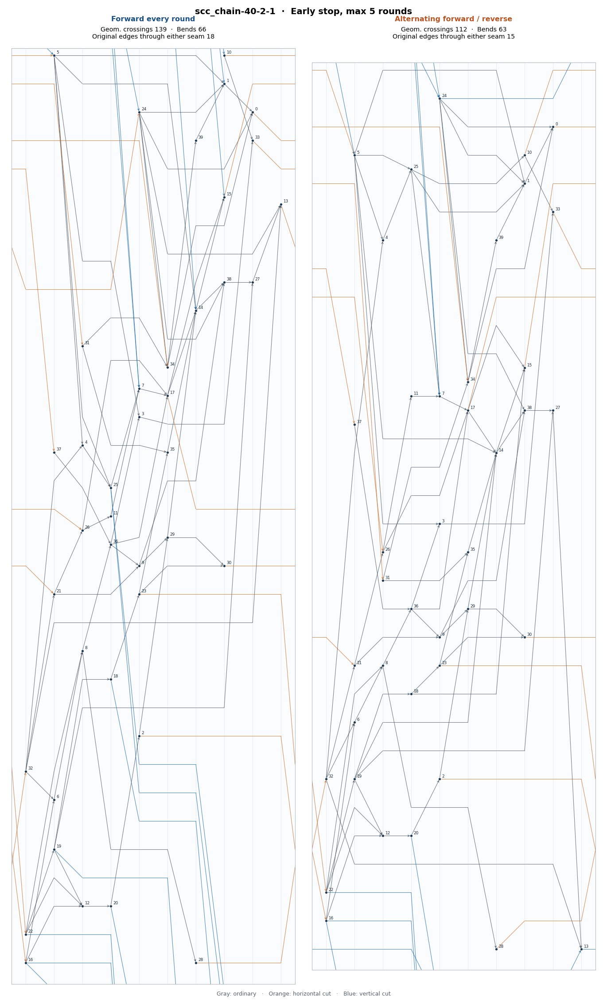
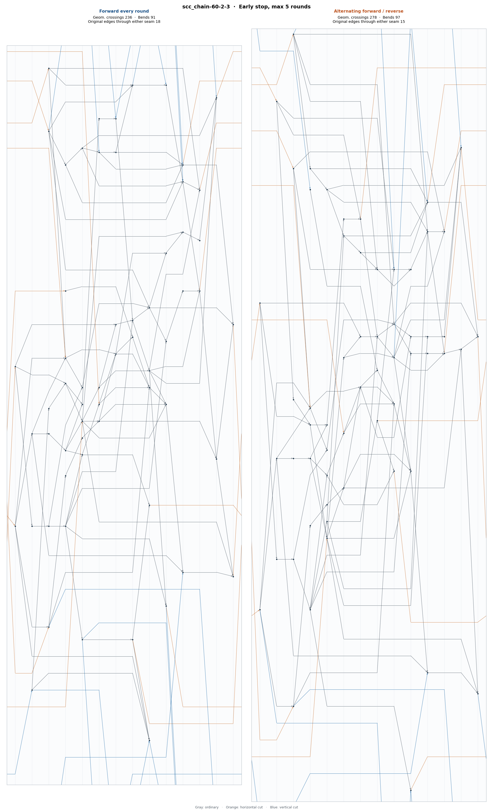

# Global sifting のブロック訪問順比較

入力は100件。階層割当の結果は `license_limit` 40件、`ok` 60件。
有効な階層割当のうち14件で、少なくとも一つのGurobiモデルが時間上限に到達した。現行の階層探索が採用し、割当の制約検証を通過した結果を共通入力として使用した。

| 頂点数 | 割当成功 | ライセンス上限 | 割当時間切れ | その他の割当失敗 | 未実行 |
| --- | ---: | ---: | ---: | ---: | ---: |
| 20 | 20 | 0 | 0 | 0 | 0 |
| 40 | 20 | 0 | 0 | 0 | 0 |
| 60 | 20 | 0 | 0 | 0 | 0 |
| 80 | 0 | 20 | 0 | 0 | 0 |
| 100 | 0 | 20 | 0 | 0 | 0 |

Δは入力ごとの「交互−順方向」。秒の列は、両条件が完走したペアで求めた各条件の中央値。
試行の分母には、階層割当の失敗とsifting時間切れを含む。図の指標は両条件で得られたペアから集計。

## 固定5周

| 頂点数 | 系列 | 試行 | 比較ペア | 減／同／増 | Δ交差 中央値 | 秒 順／交互 | Δ秒 中央値 | Δ候補 中央値 | 図ペア |
| --- | --- | ---: | ---: | ---: | ---: | ---: | ---: | ---: | ---: |
| 全体 | 全系列 | 100 | 60 | 20／17／23 | 0 | 2.706／2.685 | 0.019 | 31 | 60 |
| 20 | ランダム有向 | 5 | 5 | 1／4／0 | 0 | 0.327／0.333 | 0.015 | 10 | 5 |
| 20 | SCC連結 | 5 | 5 | 1／3／1 | 0 | 0.468／0.460 | 0.005 | 12 | 5 |
| 20 | WS | 10 | 10 | 1／7／2 | 0 | 0.371／0.369 | 0.004 | 33 | 10 |
| 40 | ランダム有向 | 5 | 5 | 1／2／2 | 0 | 2.773／2.674 | -0.032 | 88 | 5 |
| 40 | SCC連結 | 5 | 5 | 4／0／1 | -6 | 2.876／2.928 | 0.028 | 64 | 5 |
| 40 | WS | 10 | 10 | 6／1／3 | -1 | 2.577／2.603 | 0.046 | 31 | 10 |
| 60 | ランダム有向 | 5 | 5 | 3／0／2 | -10 | 9.041／9.120 | 0.094 | 50 | 5 |
| 60 | SCC連結 | 5 | 5 | 1／0／4 | 10 | 8.732／8.903 | 0.057 | -15 | 5 |
| 60 | WS | 10 | 10 | 2／0／8 | 6 | 8.900／9.046 | 0.125 | 49.5 | 10 |
| 80 | ランダム有向 | 5 | 0 | 0／0／0 | — | —／— | — | — | 0 |
| 80 | SCC連結 | 5 | 0 | 0／0／0 | — | —／— | — | — | 0 |
| 80 | WS | 10 | 0 | 0／0／0 | — | —／— | — | — | 0 |
| 100 | ランダム有向 | 5 | 0 | 0／0／0 | — | —／— | — | — | 0 |
| 100 | SCC連結 | 5 | 0 | 0／0／0 | — | —／— | — | — | 0 |
| 100 | WS | 10 | 0 | 0／0／0 | — | —／— | — | — | 0 |

条件別実行のsifting結果は `ok` 120件。描画工程の結果は `ok` 120件。従来の境界処理へのフォールバック試行は13件。

訪問回数が同じペアは60/60件。両条件で実際に観測した周で交差数が初めて異なった内訳は2周目 50件、3周目 3件、4周目 1件。共通の観測範囲で一致したのは6件。
最終交差数の対応差は-27〜+42。差があった43件での絶対差の中央値は7交差。
採点候補数は交互で減少17件、同数3件、増加40件。対応差は-206〜+342候補、時間比（交互／順）の中央値は1.010倍。

| 完成図の指標 | 比較ペア | 減／同／増 | Δ中央値 |
| --- | ---: | ---: | ---: |
| 幾何交差数 | 60 | 20／17／23 | 0 |
| 折れ数 | 60 | 20／16／24 | 0 |
| 境界を通る元辺数 | 60 | 13／28／19 | 0 |

両条件の完成図があり、埋め込み交差に差があったペアでは、幾何交差も同方向に変わったのが43件、幾何交差が同数だったのが0件、逆方向だったのが0件。埋め込み交差が同数で幾何交差が異なったのは0件。
最終の埋め込み交差が同数でも層順か巻き数が異なったのは11件。
サイズ別に最終交差数が異なったのは20頂点 6/20件、40頂点 17/20件、60頂点 20/20件。系列別の交差減／同／増はランダム有向 5／6／4、SCC連結 6／3／6、WS 9／8／13。







## 早期終了あり・上限5周

| 頂点数 | 系列 | 試行 | 比較ペア | 減／同／増 | Δ交差 中央値 | 秒 順／交互 | Δ秒 中央値 | Δ候補 中央値 | 図ペア |
| --- | --- | ---: | ---: | ---: | ---: | ---: | ---: | ---: | ---: |
| 全体 | 全系列 | 100 | 60 | 20／17／23 | 0 | 2.360／2.651 | 0.003 | 24 | 60 |
| 20 | ランダム有向 | 5 | 5 | 1／4／0 | 0 | 0.259／0.281 | 0.005 | 10 | 5 |
| 20 | SCC連結 | 5 | 5 | 1／3／1 | 0 | 0.333／0.372 | 0.003 | 19 | 5 |
| 20 | WS | 10 | 10 | 1／7／2 | 0 | 0.284／0.265 | 0.003 | 4.5 | 10 |
| 40 | ランダム有向 | 5 | 5 | 1／2／2 | 0 | 2.315／2.264 | -0.051 | -6 | 5 |
| 40 | SCC連結 | 5 | 5 | 4／0／1 | -6 | 2.356／2.891 | 0.526 | 2111 | 5 |
| 40 | WS | 10 | 10 | 6／1／3 | -1 | 2.453／2.585 | 0.012 | 31 | 10 |
| 60 | ランダム有向 | 5 | 5 | 3／0／2 | -10 | 8.953／9.267 | 0.001 | 50 | 5 |
| 60 | SCC連結 | 5 | 5 | 1／0／4 | 10 | 9.009／8.835 | 0.027 | 103 | 5 |
| 60 | WS | 10 | 10 | 2／0／8 | 6 | 8.958／9.112 | -0.002 | 45 | 10 |
| 80 | ランダム有向 | 5 | 0 | 0／0／0 | — | —／— | — | — | 0 |
| 80 | SCC連結 | 5 | 0 | 0／0／0 | — | —／— | — | — | 0 |
| 80 | WS | 10 | 0 | 0／0／0 | — | —／— | — | — | 0 |
| 100 | ランダム有向 | 5 | 0 | 0／0／0 | — | —／— | — | — | 0 |
| 100 | SCC連結 | 5 | 0 | 0／0／0 | — | —／— | — | — | 0 |
| 100 | WS | 10 | 0 | 0／0／0 | — | —／— | — | — | 0 |

条件別実行のsifting結果は `ok` 120件。描画工程の結果は `ok` 120件。従来の境界処理へのフォールバック試行は13件。

訪問回数が同じペアは41/60件。両条件で実際に観測した周で交差数が初めて異なった内訳は2周目 50件、3周目 3件、4周目 1件。共通の観測範囲で一致したのは6件。
完走ペアでの終了周は順方向が2周 1件、3周 8件、4周 15件、5周 36件、交互が2周 1件、3周 9件、4周 10件、5周 40件。
最終交差数の対応差は-27〜+42。差があった43件での絶対差の中央値は7交差。
採点候補数は交互で減少22件、同数2件、増加36件。対応差は-3953〜+4783候補、時間比（交互／順）の中央値は1.006倍。

| 完成図の指標 | 比較ペア | 減／同／増 | Δ中央値 |
| --- | ---: | ---: | ---: |
| 幾何交差数 | 60 | 20／17／23 | 0 |
| 折れ数 | 60 | 20／16／24 | 0 |
| 境界を通る元辺数 | 60 | 13／28／19 | 0 |

両条件の完成図があり、埋め込み交差に差があったペアでは、幾何交差も同方向に変わったのが43件、幾何交差が同数だったのが0件、逆方向だったのが0件。埋め込み交差が同数で幾何交差が異なったのは0件。
最終の埋め込み交差が同数でも層順か巻き数が異なったのは11件。
サイズ別に最終交差数が異なったのは20頂点 6/20件、40頂点 17/20件、60頂点 20/20件。系列別の交差減／同／増はランダム有向 5／6／4、SCC連結 6／3／6、WS 9／8／13。



全体平均では早期終了後の周に最終値を延長した。個別例は実際に観測した周まで表示。





## 固定周数と早期終了

同じ入力・訪問順で両モードが完走した120条件のうち、最終層順・巻き数が一致したのは120条件。採用移動が一度もない周では、すべてのブロックが同じ状態で採点される。その状態からさらに周を重ねても、どちらの訪問方向でも採用できる移動は発生しない。

## 設定と再現

- 完成図の比較画像を108枚保存。画像保存の失敗は0件。保存に失敗した場合は `drawing_errors.csv` に記録。
- 20・40・60・80・100頂点、各サイズでランダム有向5件、SCC連結5件、WS 10件。辺は2n本。ランダム有向・SCC連結は既存トーラス研究の生成器。WSは近傍4、再配線0.8、seed 0〜9、連結条件付きの前回WS実験の設定。
- 入力の来歴は `torus_study.inputs.generate` 46件、`evaluate_torus_sweep_ws100.py parameters` 50件、`output/torus_experiment_20261120/scaling/inputs.jsonl` 4件。
- 階層割当は既存の探索とdiff_square。ローカルライセンス、モデルごと1秒、1スレッド、solver seed 0。 siftingは1条件あたり30秒を上限とした。
- 階層割当が時間切れで解を返さなかった入力のみ、モデルごと3秒で4件を再試行した。初回のログを `prepared/` の `previous_attempt` に保存した。
- 初期値は既定のbarycenter順を共有ブロック順へ射影した直後で、全巻き数は0。各周の開始時に訪問順をスナップショット化し、確定した移動を即時反映する。
- 本計測前に20頂点で、第1周の訪問順、層順、巻き数の一致と、早期終了ありの順方向が変更前の実装と同じ最終状態になることを確認した。
- 実行順を入力ごとに入れ替え、siftingカーネルを直列で1回計時。計数と各周の交差数は同じ入力での別実行で測り、全完走試行で最終状態の一致を確認。スキップ後に採点へ進んだ挿入位置を各1候補と数えた。時間切れ試行では上限到達時間を記録した。
- 一部入力の計数は複数プロセスで再実行し、全て完了してから次の入力の計時に進んだ。再実行のプロセス数は各ケースの `trace_workers` に保存した（省略時は1）。
- 完成図は既定の同時境界最適化と分割なしBrandes–Köpf座標。既定パイプラインと同条件で従来の境界処理へのフォールバックを適用。境界を通る元辺数は左右・上下の和集合。図は左が順方向、右が交互で、横1層64 px、上下は余白調整。

保存先は `inputs.json`（入力）、`settings.json`（条件）、`pilot.json`（予備検証）、`prepared/`（割当、境界フラグ、分割、初期順・巻き数、solverログ）、`cases/`（両条件の周ごとの訪問順・交差数・候補数および最終層順・巻き数、完成図用座標）、`measurements.csv`、`summary_fixed.csv`、`summary_early.csv`、`paired_trajectories.csv`、`divergence.csv`、`drawings.csv`（完成図の索引）。

```sh
export PYTHONHASHSEED=0 PYTHONPATH=src MPLCONFIGDIR=/tmp/torus-block-mpl
./theme2026-saku/bin/python experiments/evaluate_global_block_order.py --trace-workers 4
./theme2026-saku/bin/python experiments/evaluate_global_block_order.py --trace-workers 4 --retry-layer-seconds 3
./theme2026-saku/bin/python experiments/report_global_block_order.py
```

計測コマンドは既存のケース結果から再開する。時間も再計測する場合は別の `--output` を指定。同じ初期配置を使うには、新しい出力先へ保存済みの `inputs.json` と `prepared/` をコピーしてから実行する。レポートコマンドは保存済みデータから表と図を再生成する。

変更前の実装との予備比較を再実行する場合は、新しい出力先を指定し、計測コマンドに `--pilot-only --baseline output/global_block_order_20261126/baseline_global_sifting.py` を加える。
