# 有向グラフを描画するための一手法

Emden R. Gansner, Eleftherios Koutsofios, Stephen C. North, Kiem-Phong Vo

> 原題：_A Technique for Drawing Directed Graphs_  
> 掲載誌：_IEEE Transactions on Software Engineering_, Vol. 19, No. 3, pp. 214–230, March 1993  
> DOI：10.1109/32.221135  
> 翻訳元：ユーザーのZoteroライブラリに保存されたIEEE掲載版PDF（17ページ）。親アイテム：`TTZP3WKE`、添付PDF：`8PD5NHVC`。  
> 本文を省略せずに翻訳し、原論文の節構成、図番号、文献番号を保持した。数式と擬似コードはPDF画像と照合して転記した。図の描画部分は原図を収録し、キャプションを日本語訳した。図中のデータ名・記号、プログラムの識別子・構文、および参考文献の書誌情報は原文を保持し、参考文献の題名には日本語訳を併記した。原文の記述に関する訳注は、本文と区別して末尾にまとめた。

## 要旨

有向グラフを描画するための4パスのアルゴリズムを述べる。第1パスでは、ネットワーク単体法を用いて最適な階層割当てを求める。第2パスでは、新しい重み関数と局所的な位置交換を組み込んだ反復的ヒューリスティクスによって、階層内の頂点順序を定め、交差を減らす。第3パスでは、補助グラフを構築して階層を割り当てることにより、ノードの最適な座標を求める。第4パスでは、辺を描くためのスプラインを作る。このアルゴリズムは良好な描画を生成し、高速に動作する。

**索引用語**：有向グラフのレイアウトアルゴリズム、ネットワーク単体法。

## I. はじめに

抽象的なグラフの描画は、プログラムやデータ構造の可視化、文書作成などの応用を持つ、継続的に研究されている話題である。本論文は、有向グラフを平面上に描画するための一手法を述べる。目標は、対話的な利用に十分な速さで、高品質な描画を生成することである。これらのアルゴリズムは、実用的な実装 [1] の基礎となっている。

### A. 美的基準

描画を行うには、有向グラフに、上から下へ（本論文のほとんどの例で仮定する方向）や左から右へといった、全体的な流れ、すなわち方向があると仮定すると役立つ。このような流れは、初期状態から終端状態へ向かう有限オートマトンの手描きの図や、入力から出力へ向かうデータフローグラフに見られる。この観察により、次の美的原則に基づく有向グラフ描画の一群の手法が動機づけられている。

- **A1**：グラフの階層構造を明示する。特に、可能ならば辺をおおむね同じ方向に向ける。これにより有向路を見つけやすくなり、ソースノードとシンクノードが際立つ。
- **A2**：基礎となるグラフについての情報を伝えない視覚的な不自然さを避ける。たとえば、辺の交差や急な屈曲を避ける。
- **A3**：辺を短く保つ。これにより関連するノードを見つけやすくなり、A2にも寄与する。
- **A4**：対称性とバランスを重視する。この美的原則は、我々のアルゴリズムのいくつかの箇所で補助的な役割を持つ。

これらすべての美的基準を同時に最適化する方法はない。たとえば、A1に従って望ましいノード配置や辺の方向を選ぶと、A2に照らして望ましくない辺交差が不可避になることがある。さらに、辺交差を最小化することや、対称性を持つ部分グラフを見つけることは、計算上困難である。したがって、我々はいくつかの単純化のための仮定を置き、高速に動作し、通常の場合に良好なレイアウトを生成するヒューリスティクスに依存する。他の美的原則の概観については、グラフ描画アルゴリズムの注釈付き文献一覧 [2] を参照されたい。

### B. 問題の記述

描画アルゴリズムへの入力は、自己ループや多重辺を含む可能性のある属性付きグラフ $G=(V,E)$ である。各連結成分は個別にレイアウトできるため、$G$ は連結であると仮定する。属性は次のとおりである。

| 属性                | 内容                                                                                               |
| ------------------- | -------------------------------------------------------------------------------------------------- |
| $xsize(v),ysize(v)$ | ノード $v$ の外接矩形の大きさ。                                                                    |
| $nodesep(G)$        | ノードの矩形間の最小水平間隔。                                                                     |
| $ranksep(G)$        | ノードの矩形間の最小垂直間隔。                                                                     |
| $\omega(e)$         | 辺 $e$ の重み。通常は1。重みは辺の重要性を表し、その辺を短く保ち、垂直にそろえることに反映される。 |

アルゴリズムは各ノード $v$ に、平面上で中心点が $(x(v),y(v))$ の矩形を割り当て、各辺 $e$ に、Bスプラインの制御点列 $(x_0(e),y_0(e)),\ldots,(x_n(e),y_n(e))$ を割り当てる。これらの寸法の単位は指定されていないが、実装では1インチを72単位とする従来の座標系を用いると便利である。レイアウトは一般には美的基準A1–A4に、具体的にはグラフの属性に従う。これらの制約の詳細は後続の節で述べる。

利用者は、時間軸を持つグラフの描画や、ソースノードとシンクノードの強調に役立つ形で、レイアウトにさらに制約を加えることができる。次節で述べるアルゴリズムの最初のパスでは、ノードを離散的な階層 $0,\ldots,Max\_rank$ に割り当てる。同じ階層のノードには同じ $Y$ 座標値が与えられる。利用者は集合 $S_{max},S_{min},S_0,S_1,\ldots,S_k\subseteq V$ を与えることができる。これらはそれぞれ、最大階層、最小階層、または同じ階層に一緒に配置しなければならないノードの集合であり、空集合であってもよい。

### C. 関連研究

辺交差を減らす反復的な方法による有向グラフ描画は、Warfield [3] によって初めて研究され、類似の方法はCarpano [4]、およびSugiyama、Tagawa、Toda [5] によって発見された。Di BattistaとTamassiaは、すべての辺が同じ方向へ流れるように、平面的な非巡回有向グラフを埋め込むアルゴリズムを述べている [6]。我々の研究は、Warfieldらのアプローチを基礎に発展させたものと考えている。

### D. 概観

グラフ描画アルゴリズムには、図1に示すように4つのパスがある。第1パスはノードを離散的な階層に配置する。第2パスは、辺交差を避けるために階層内のノード順序を定める。第3パスは、ノードの実際のレイアウト座標を定める。最後のパスは、辺のスプライン制御点を求める。

```text
1. procedure draw_graph()
2. begin
3.     rank();
4.     ordering();
5.     position();
6.     make_splines();
7. end
```

**図1　主要アルゴリズム。**

我々の貢献は、1）ネットワーク単体法を用いてノードに効率よく階層を割り当てる方法、2）辺交差を減らすための改善されたヒューリスティクス、3）ノード座標を階層割当て問題として計算する方法、4）スプライン制御点を定める方法である。手法1）と2）は、[1] に述べられているグラフ描画プログラム `dag` に最初に実装された。その後の研究成果、特に3）と4）は、`dag` の後継である `dot` [7] に組み込まれた。図2と図3は、対応する入力ファイルとともに示した `dot` の出力例である。

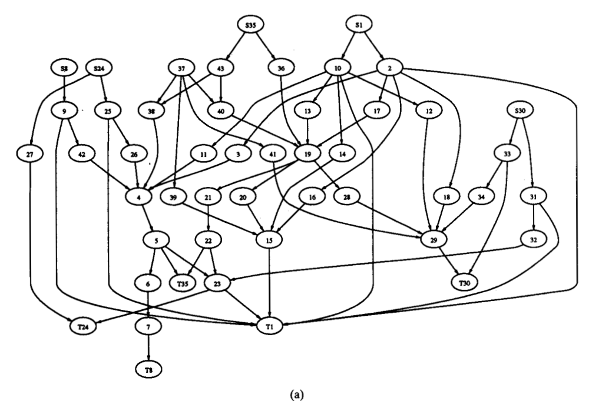

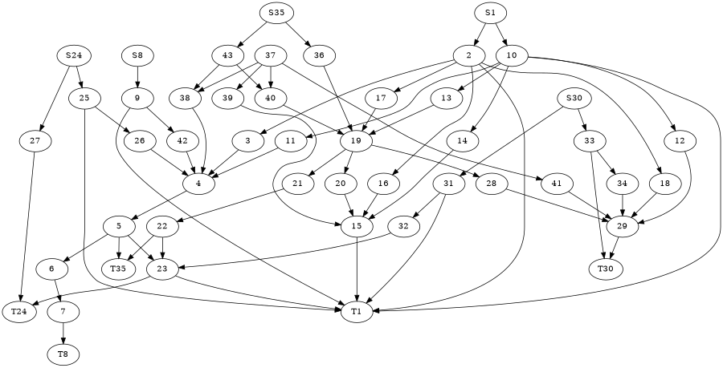

**図2　(a) Sun-4/280でのユーザーCPU時間は1.11秒。(b) グラフファイルのリスト。**

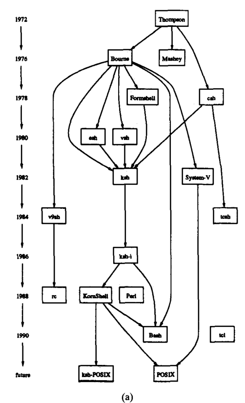

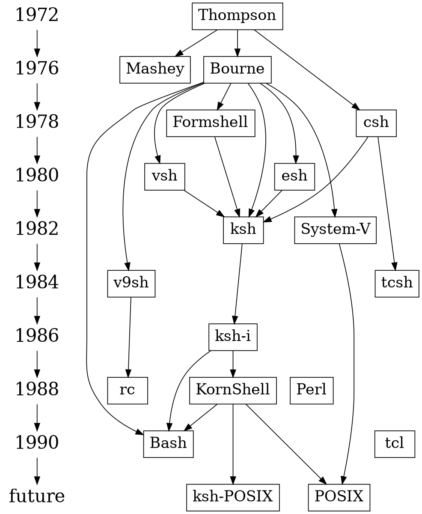

**図3　(a) Sun-4/280でのユーザーCPU時間は0.50秒。(b) グラフファイルのリスト。**

## II. 最適な階層割当て

第1パスは、各ノード $v\in G$ に、その辺と整合する整数の階層 $\lambda(v)$ を割り当てる。これは、すべての $e=(v,w)\in E$ について $l(e)\geq\delta(e)$ となることを意味する。ここで、$e=(v,w)$ の長さ $l(e)$ は $\lambda(w)-\lambda(v)$ と定義され、$\delta(e)$ は与えられた最小長制約を表す。$\delta(e)$ は通常1であるが、任意の非負整数値を取ることができる。$\delta(e)$ は、以下に述べる技術的な理由で内部的に設定されることも、利用者が階層割当てを調整したい場合に外部から設定されることもある。このパスでは、空でない集合 $S_{max},S_{min},S_0,\ldots,S_k$ はそれぞれ、一時的に1つのノードに併合される。また、自己ループは無視し、多重辺は、併合する辺の重みの総和を重みとする1本の辺に併合する。効率のため、上記のいずれの集合にも属さない葉ノードは無視してもよい。最適な階層割当てでは、葉の階層は自明に決まるからである。

### A. グラフの非巡回化

整合的な階層割当てを持つためには、グラフは非巡回でなければならない。入力グラフは閉路を含む可能性があるため、前処理で閉路を検出し、いくつかの辺を反転させて閉路を断つ [8]。もちろん、これらの辺は内部的にのみ反転され、描画の矢印は元の方向を示す。閉路を断つための有用な手続きは、深さ優先探索に基づいている。ソースノードまたはシンクノードがあればそこから開始し、グラフ入力の「自然な順序」で辺を探索する。深さ優先探索は辺を木辺と非木辺の2つの集合に分割する [9]。木はノード上の半順序を定める。この半順序を用いると、非木辺はさらに交差辺、前進辺、後退辺の3つの集合に分割される。交差辺は、この半順序において比較不能なノード同士を結ぶ。前進辺は、ノードとその子孫のいずれかを結ぶ。後退辺は、子孫とその祖先のいずれかを結ぶ。半順序に前進辺と交差辺を追加しても閉路を作らないことは明らかである。後退辺を反転すると前進辺になるため、この手続きによってすべての閉路が断たれる。

反転させる辺の集合を、より小さく、あるいは最小にしようとするのは妥当に思える。困難の1つは、最小の集合を求める問題（「フィードバック辺集合」問題）がNP完全であることである [10], [11]。さらに重要なのは、それによって描画がおそらく改善されないという点である。我々は、多くの閉路に関与する辺を反転させるヒューリスティクスを実装した。このヒューリスティクスは、非自明な強連結成分を任意の順序で1つずつ取り上げる。各成分内で、深さ優先走査中に各辺が閉路を形成する回数を数える。回数が最大の辺を反転する。非自明な強連結成分がなくなるまでこれを繰り返す。

このヒューリスティクスによる実験は、実際の応用に現れる有向グラフの大部分が、閉路を含む場合でも自然な辺の方向を持つことを示している。グラフ入力は通常、この自然な方向を反映する。実際、グラフはしばしば、別のツールが行うグラフ探索によって生成される。不適切な辺を反転すると描画が乱れる。たとえば、手続き呼出しグラフが閉路を持つ場合でも、最上位の関数は図の中央のどこかではなく、上端付近に現れることが期待される。安定性の観点からは、深さ優先探索による閉路除去ヒューリスティクスが望ましいように思われる。また、さまざまな研究者が提案したように、閉路内の全ノードを1つに縮約したり、閉路内のノードを同じ階層に配置したり、閉路内のノードの1つを複製したりする方法 [4], [12], [5] よりも、情報をよく伝える描画を生成する。

もう1つの詳細は、$S_{max}$ と $S_{min}$ を表すノードには、常に最大階層と最小階層を割り当てなければならないという点である。この性質は、$S_{max}$ の出辺と $S_{min}$ の入辺を反転させることにより保証される。また、入辺を持たないすべてのノード $v$ に対して、$\delta=0$ の一時的な辺 $(S_{min},v)$ を作り、出辺を持たないすべてのノード $v$ に対して、$\delta=0$ の一時的な辺 $(v,S_{max})$ を作る。したがって、すべての $v$ について

$$
\lambda(S_{min})\leq\lambda(v)\leq\lambda(S_{max})
$$

となる。

### B. 問題の定義

原則A3は、辺を短くすることを求める。辺を短くすればレイアウトが改善されるだけでなく、実行時間が辺の総延長に依存する後続パスの実行時間も減る。したがって、最適なノードの階層割当て、すなわち、重み付き辺長の総和が最小になる割当てを求めることが望ましい。

最適な階層割当てを求める問題は、次の整数計画問題として再定式化できる。

$$
\min\;\sum_{(v,w)\in E}\omega(v,w)\bigl(\lambda(w)-\lambda(v)\bigr)
$$

制約：

$$
\lambda(w)-\lambda(v)\geq\delta(v,w),\qquad\forall(v,w)\in E.
$$

前述の重み関数 $\omega$ と最小長関数 $\delta$ は、それぞれ辺集合 $E$ を非負の有理数と非負の整数へ写す。

この整数計画問題を多項式時間で解く方法はさまざまにある。1つの方法は、同値な線形計画問題を解き、その解を多項式時間で整数解に変換することである。別の方法は、最適階層割当て問題を、それと同値な最小費用流問題または最小費用循環流問題に変換することであり、これらには多項式時間アルゴリズムがある（[13] とその参考文献を参照）。制約行列が完全単模であるため、必ずしも多項式時間ではないが、単体法を適用してこの問題を解くこともできる。これらおよび他の手法についての、より完全な議論は [14] で報告する予定である。

### C. ネットワーク単体法

ここでは、ネットワーク単体法の定式化 [15] に基づく、この問題への簡単なアプローチを述べる。その時間計算量が多項式であることは証明されていないが、実際には少ない反復回数で高速に動作する。

まず、いくつかの定義と観察から始める。**実行可能な階層割当て**とは、すべての $e$ について長さ制約 $l(e)\geq\delta(e)$ を満たす割当てである。実行可能であるとは限らない任意の階層割当てに対し、辺の**スラック**は、その長さと最小長の差である。したがって、すべての辺のスラックが非負ならば、階層割当ては実行可能である。スラックが0の辺を**タイト**という。

グラフの全域木は、階層割当て、より正確には同値な階層割当ての族を誘導する。（この全域木は、基礎となる根なし無向グラフ上のものであり、必ずしも有向木ではないことに注意されたい。）この割当ては、最初のノードを選んで階層を与えることにより生成する。その後、階層が割り当てられたノードに全域木内で隣接する各ノードに対し、接続辺の終点側か始点側かに応じて、その辺の最小長だけ隣接ノードの階層を増減させて割り当てる。すべてのノードに階層が割り当てられるまでこの処理を続ける。実行可能な階層割当てを誘導する全域木を**実行可能**という。構成上、実行可能木のすべての辺はタイトである。

実行可能な全域木が与えられたとき、各木辺に整数の**カット値**を次のように対応させることができる。その木辺を削除すると、木は2つの連結成分に分かれる。一方は辺の始点ノードを含む始点側成分であり、他方は辺の終点ノードを含む終点側成分である。カット値は、当該木辺を含む、始点側成分から終点側成分へのすべての辺の重みの総和から、終点側成分から始点側成分へのすべての辺の重みの総和を引いた値として定義される。

通常は（ただし、退化のため常にそうなるわけではない）、カット値が負であることは、終点側成分から始点側成分への辺の1本がタイトになるまで、その木辺を可能な限り長くすることによって、重み付き辺長の総和を減らせることを示す。これは、全域木の木辺を新たにタイトになった辺と交換して、新しい実行可能な全域木を得ることに対応する。また、最適な階層割当てから、実行可能な全域木によって誘導される別の最適な階層割当てを生成できることも容易に分かる。これらの観察は、階層割当て問題を代数的な形ではなくグラフによる形で解くための鍵である。すべての木辺のカット値が非負になるまで、カット値が負の木辺を適切な非木辺と交換する。終了を保証するためには、実装で巡回防止の手法を用いるべきであるが、我々は実際にその必要が生じたことはない。得られた全域木は最適な階層割当てに対応する。ネットワーク単体法の終了と結果の最適性についてのさらなる議論に関心がある読者は、文献 [14]–[16] を参照されたい。

図4は、我々のネットワーク単体法を示す。

```text
1. procedure rank()
2.     feasible_tree();
3.     while (e = leave_edge()) ≠ nil do
4.         f = enter_edge(e);
5.         exchange(e,f);
6.     end
7.     normalize();
8.     balance();
9. end
```

**図4　ネットワーク単体法。**

**図4に関する説明**

- **2**：関数 `feasible_tree` は、最初の実行可能な全域木を構築する。この手続きについては、すぐ後でさらに詳しく述べる。単体法は実行可能解から開始し、この不変条件を維持する。
- **3**：`leave_edge` は、負のカット値を持つ木辺を返す。そのような辺がなければ `nil` を返し、解が最適であることを意味する。負のカット値を持つ任意の辺を、除去する辺として選んでよい。
- **4**：`enter_edge` は、$e$ と交換する非木辺を求める。辺 $e$ を切ることによって木を終点側成分と始点側成分に分割し、終点側成分から始点側成分へ向かうすべての辺を検討して、スラックが最小の辺を選ぶ。これは実行可能性を維持するために必要である。
- **5**：辺を交換して、木とそのカット値を更新する。
- **7**：最小階層を0に設定して、解を正規化する。
- **8**：入辺と出辺の重みが等しく、複数の実行可能な階層を持つノードを、ノード数が最も少ない実行可能な階層に移す。目的は、原則A4に従って混雑を減らし、描画の縦横比を改善することである。この調整は階層割当ての費用を変えない。ノードは貪欲に調整され、この方法は十分よく機能する。階層の大域的なバランス調整については、今後の論文 [14] で検討する。

図5は、最初の実行可能木を構築する方法を示す。

```text
 1. procedure feasible_tree()
 2.     init_rank();
 3.     while tight_tree() < |V| do
 4.         e = 木に接続する非木辺で、
 5.             スラックが最小のもの;
 6.         delta = slack(e);
 7.         if 接続ノードが e.head then delta = -delta;
 8.         for v in Tree do v.rank = v.rank + delta;
 9.     end
10.     init_cutvalues();
11. end
```

**図5　最初の実行可能木の探索。**

**図5に関する説明**

- **2**：最初の実行可能な階層割当てを計算する。簡潔にするため、ここでは `init_rank` を示さない。我々の実装は、ノードをキューに保持する。未走査の入辺を持たなくなったノードをキューに入れる。ノードをキューから取り出すと、その入辺を満たす最小の階層を割り当て、出辺を走査済みとする。すべての辺で $\delta=1$ という最も単純な場合、これはグラフを半順序集合と見なし、極小元を階層0に割り当てることに対応する。これらのノードを半順序集合から除去し、新たな極小元の集合を階層1に割り当てる、といった処理を行う。
- **3**：関数 `tight_tree` は、ある固定ノードを含むタイトな辺の極大木を求め、その木のノード数を返す。このような極大木は、基礎となる無向グラフにおいて、タイトな辺だけを用いてその固定ノードから到達できるすべてのノードが誘導する部分グラフの全域木にほかならないことに注意されたい。特に、そのような木はすべて同じノード数を持つ。
- **4–8**：木に隣接する木外のノードへの辺を求め、木のノードの階層を調整して、この辺をタイトにする。スラックが最小の辺を選んでいるため、結果の階層割当ては依然として実行可能である。したがって、反復ごとにタイトな辺の極大木は少なくとも1つのノードを獲得し、アルゴリズムは最終的に実行可能な全域木を得て終了する。この手法は、本質的にはSugiyamaら [5] が述べたものである。
- **10**：関数 `init_cutvalues` は、木辺のカット値を計算する。各木辺について、ノードが終点側成分と始点側成分のどちらに属するかを印付けし、始点と終点が異なる成分に属するすべての辺の、符号付きの重みを合計する。終点側成分から始点側成分に向かう辺の符号は負とする。

ネットワーク単体法の小さな実行例を図6に示す。非木辺は点線であり、すべての辺の重みは1である。(a) は最初の階層割当て後のグラフを示しており、カット値も記している。たとえば、辺 $(g,h)$ のカット値は $-1$ であり、これは、辺 $(g,h)$ の重み（始点側成分から終点側成分へ）から、辺 $(a,e)$ と $(a,f)$ の重み（終点側成分から始点側成分へ）を引いたものに対応する。(b) では、負のカット値を持つ辺 $(g,h)$ を非木辺 $(a,e)$ と交換し、新たなカット値を示している。すべて非負であるため、解は最適であり、アルゴリズムは終了する。

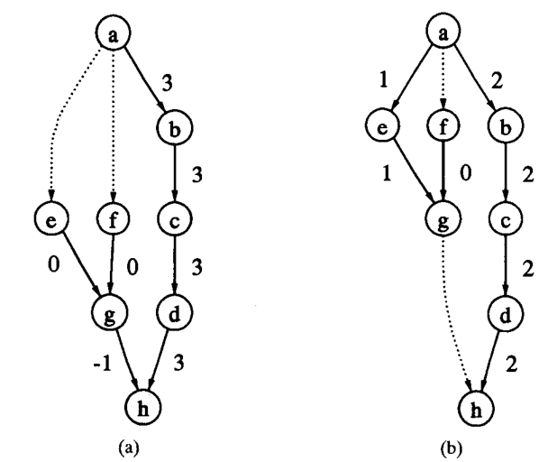

**図6　最適な実行可能木の探索。**

### D. 実装の詳細

ネットワーク単体法の各種の方式はよく理解されており、実装の調整に役立つ結果が文献にある [15]。しかし、これから実装する人に向けて、いくつかの具体的な点を指摘しておく価値があると考える。これらの最適化はここでも有用であるが、第IV節で、はるかに大きなグラフにネットワーク単体法を再び適用するときには不可欠になる。

最初の実行可能木と初期カット値の計算は、ネットワーク単体法を実行する費用のかなりの部分を占めることが多い。実際に現れる多くのグラフでは、初期解は最適解に近く、最終解に達するにはわずか数回の反復しか必要としない。素朴な実装では、すべての木辺を1本ずつ取り上げて切り、各ノードが終点側成分と始点側成分のどちらに属するかを印付けして合計することで、初期カット値を求めることができる。これには $O(VE)$ 時間を要する。

この費用を減らすため、探索を実行可能木の葉から内部へ向かう順序で行えば、辺に局所的な情報を使ってカット値を計算できることに着目する。端点の一方が木の葉である木辺のカット値は、終点側成分または始点側成分が単一のノードからなるため、容易に計算できる。次に、あるノードに接続する辺のうち、1本を除くすべてについてカット値が分かっていると仮定する。このとき、残りの辺のカット値は、既知のカット値の和に、そのノードに接続する辺だけに依存する項を加えたものになる。

この計算を図7で示す。カット値が既知の2本の木辺が、図示された方向で3本目につながる場合である。他の場合も同様に扱える。$(u,w)$ と $(v,w)$ のカット値が既知であると仮定する。大文字でラベル付けされた辺は、図示された成分に始点と終点が属し、示された方向を持つすべての非木辺の集合を表す。$(u,w)$ と $(v,w)$ のカット値は、それぞれ

$$
c_{(u,w)}=\omega(u,w)+A+C+F-B-E-D
$$

および

$$
c_{(v,w)}=\omega(v,w)+L+I+D-K-J-C
$$

で与えられる。すると、$(w,x)$ のカット値は

$$
\begin{aligned}
c_{(w,x)}
&=\omega(w,x)+G-H+A-B+L-K\\
&=\omega(w,x)+G-H+\bigl(c_{(u,w)}-\omega(u,w)-C-F+E+D\bigr)\\
&\quad+\bigl(c_{(v,w)}-\omega(v,w)-I-D+J+C\bigr)\\
&=\omega(w,x)+G-H+c_{(u,w)}-\omega(u,w)\\
&\quad+c_{(v,w)}-\omega(v,w)-F+E-I+J
\end{aligned}
$$

となり、局所的な辺の情報と既知のカット値だけを含む式になる。このようにカット値を逐次計算することで、すべての辺を2回だけ調べればよいことを保証できる。これにより、初期カット値の計算時間を大幅に減らせる。

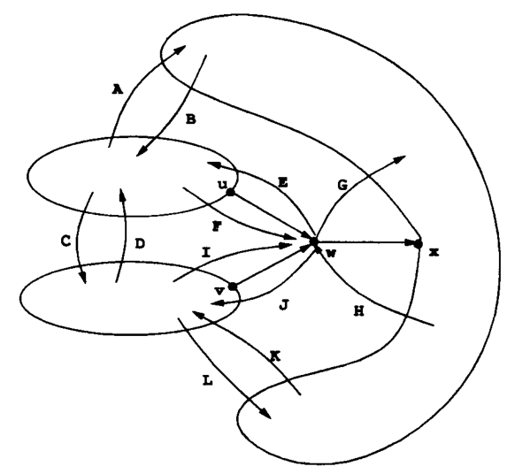

**図7　カット値の逐次計算。**

もう1つの有用な最適化は、[15] に述べられた手法と類似しており、固定した根ノード $v_{root}$ から木の後順走査を行い、各ノード $v$ に、その後順走査番号 $lim(v)$、探索における子孫の番号の最小値 $low(v)$、およびそのノードに到達した辺 $parent(v)$ を付けることである（図8参照）。これにより、ノードが木辺の終点側成分と始点側成分のどちらにあるか、したがって、非木辺が2つの成分を横断するかどうかを、低い費用で判定できる。たとえば、$e=(u,v)$ が木辺で、$v_{root}$ がその辺の終点側成分にある場合（すなわち $lim(u)<lim(v)$）、ノード $w$ が $e$ の始点側成分にあることと

$$
low(u)\leq lim(w)\leq lim(u)
$$

であることは同値である。これらの番号は、ネットワーク単体法の反復中に木を効率よく更新するためにも利用できる。$f=(w,x)$ が入る辺であるとき、カット値を調整する必要がある辺は、木内で $w$ と $x$ を結ぶ経路上の辺だけである。この経路は、$w$ と $x$ から `parent` 辺を遡り、最小共通祖先、すなわち

$$
low(l)\leq lim(w),lim(x)\leq lim(l)
$$

を満たす最初のノード $l$ に到達するまでたどることで求められる。もちろん、木辺を交換するときには、これらの後順走査のパラメータも調整しなければならないが、対象は $l$ より下のノードだけでよい。

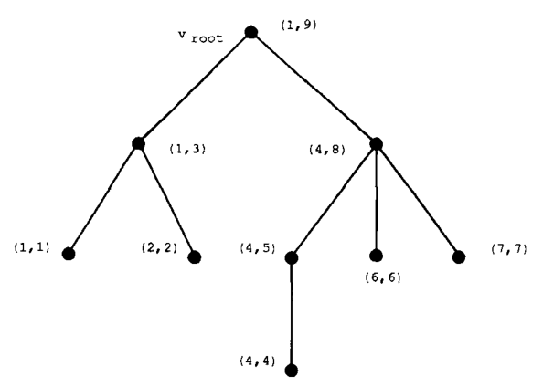

**図8　ノードを $(low,lim)$ でラベル付けした後順走査。**

ネットワーク単体法は、交換する負の辺の選択にも非常に敏感である。我々は、毎回木辺のリストの先頭から探索する代わりに、すべての木辺を循環的に探索すると、多くの反復を省けることを観察した。

## III. 階層内の頂点順序

階層割当ての後、階層の差が1より大きいノード間の辺を、一時的な、すなわち「仮想」ノード間の単位長の辺の連鎖で置き換える。仮想ノードを中間の階層に配置することで、元のグラフを、辺が隣接する階層のノードだけを結ぶグラフに変換する。このパスでは自己辺を無視し、前のパスと同様に多重辺を併合する。

階層内の頂点順序は、レイアウトにおける辺交差を決定する。したがって、良い順序とは交差が少ない順序である。階層が割り当てられたグラフのレイアウトにおける辺交差の最小化は、階層が2つだけの場合でもNP完全であるため、ヒューリスティクスが適している [10]。

階層付きグラフの辺交差を減らすためのいくつかの重要なヒューリスティクスは、Warfield [3] が最初に提案した次の方式に基づいている。まず、各階層内の初期順序を計算する。続いて、順序の改善を試みる一連の反復を行う。各反復では、最初の階層から最後の階層へ、または逆方向に走査する。階層を訪問すると、その階層の各頂点に、直前の階層にある隣接頂点の相対位置に基づく重みを割り当てる。そして、これらの重みを用いてソートすることにより、階層内の頂点の順序を変更する。

よく用いられる頂点の重み付け方法には、重心関数 [5] と中央値関数 [17] の2つがある。$v$ を頂点、$P$ を、対象となる隣接階層にある隣接頂点の位置のリストとする。ここで、隣接ノードの位置とは、現在の順序における単なる順番であることに注意されたい。重心法は、$v$ の重みを $P$ の要素の平均として定義する。中央値法は、$v$ の重みを $P$ の要素の中央値として定義する。$P$ の要素数が偶数の場合、中央値は2つある。このことから、常に左側の中央値を使う方法と、常に右側の中央値を使う方法という、2つの中央値法が生じる。中央値法は一貫して重心法よりも良い結果を示し、理論上も多少の利点がある。EadesとWormald [17] が、2階層グラフの中央値によるレイアウトでは、交差数が最小交差数の3倍を超えないことを示しているからである。重心法については、そのような上界は知られていない。

我々のノード順序付けヒューリスティクスは、中央値法を改良したものであり、2つの主要な新機軸を持つ。第1に、中央値が2つある場合、頂点がより密に詰まっている側へ偏らせた補間値を用いる。第2の改善は、頂点をソートした後に明らかな交差を減らす追加のヒューリスティクスを用い、与えられた順序を、隣接頂点の位置交換に関して局所最適な順序に変換することである。これは通常、辺交差をさらに20–50%減らす。詳しい統計については [1] を参照されたい。

図9は、ノード順序付けアルゴリズムを示す。

```text
 1. procedure ordering()
 2.     order = init_order();
 3.     best = order;
 4.     for i = 0 to Max_iterations do
 5.         wmedian(order,i);
 6.         transpose(order);
 7.         if crossing(order) < crossing(best) then
 8.             best = order;
 9.     end
10.     return best;
11. end
```

**図9　頂点順序付けアルゴリズム。**

**図9に関する説明**

- **2**：`init_order` は、各階層のノードを初期順序に並べる。これは、最小階層の頂点から始める深さ優先探索または幅優先探索によって行うことができる。探索が進むにつれて、頂点にはその階層内で左から右の順に位置を割り当てる。この方針は、木の初期順序に交差がないことを保証する。このような交差は、明らかで容易に避けられる「間違い」であるため、これは重要である。
- **4–9**：`Max_iterations` は最大反復回数である。我々は `Max_iterations` を24に設定している。各反復で交差数が改善すれば、新たな順序を保存する。実際の実装では、直近の数回の反復で解が少なくとも数パーセント改善している限り反復を続ける、適応的な方針のほうが望ましいかもしれない。`wmedian` は、重み付き中央値ヒューリスティクスに基づいて各階層内のノードを並べ替える。`transpose` は、交差数が減る場合に、同じ階層の隣接頂点を繰り返し交換する。これら2つの関数は以下でさらに詳しく述べる。

重み付き中央値ヒューリスティクスを図10に示す。現在の反復番号の偶奇に応じて、階層を上から下へ、または下から上へ走査する。説明を簡単にするため、図10では一方向だけを詳しく示す。

```text
 1. procedure wmedian(order,iter)
 2.     if iter mod 2 == 0 then
 3.         for r = 1 to Max_rank do
 4.             for v in order[r] do
 5.                 median[v] = median_value(v,r-1);
 6.             sort(order[r],median);
 7.         end
 8.     else ...
 9.     endif
10. end
11.
12. procedure median_value(v,adj_rank)
13.     P = adj_position(v,adj_rank);
14.     m = |P|/2;
15.     if |P| = 0 then
16.         return -1.0;
17.     elseif |P| mod 2 == 1 then
18.         return P[m];
19.     elseif |P| = 2 then
20.         return (P[0] + P[1])/2;
21.     else
22.         left = P[m-1] - P[0];
23.         right = P[|P|-1] - P[m];
24.         return (P[m-1]*right + P[m]*left)/(left+right);
25.     endif
26. end
```

**図10　重み付き中央値ヒューリスティクス。**

**図10に関する説明**

- **1–10**：階層の順方向走査では、主ループは階層1から開始し、最大階層で終わる。各階層で、頂点には前の階層の隣接頂点に基づく中央値を割り当てる。そして、その中央値によって階層内の頂点をソートする。重要な検討事項は、前の階層に隣接頂点を持たない頂点をどう扱うかである。我々の実装では、そのような頂点は現在の位置に固定し、固定されていない頂点を残りの位置へソートして配置する。
- **12–26**：頂点の中央値は、隣接頂点の位置の中央値が一意に定まる場合には、その値として定義する。それ以外の場合には、密集度の尺度を使って2つの中央値の位置の間を補間する。一般に、重み付き中央値は、頂点がより密に詰まっている側に偏る。
- **13**：関数 `adj_position` は、与えられた隣接階層にある、$v$ に隣接するノードの現在位置を、順序付き配列として返す。
- **15–16**：隣接頂点を持たないノードには、中央値 $-1$ を与える。これは `sort` 関数内で、これらのノードを現在の位置に残すべきことを示すために用いる。

図11は、位置交換ヒューリスティクスを示す。

```text
 1. procedure transpose(rank)
 2.     improved = True;
 3.     while improved do
 4.         improved = False;
 5.         for r = 0 to Max_rank do
 6.             for i = 0 to |rank[r]|-2 do
 7.                 v = rank[r][i];
 8.                 w = rank[r][i+1];
 9.                 if crossing(v,w) > crossing(w,v) then
10.                     improved = True;
11.                     exchange(rank[r][i],rank[r][i+1]);
12.                 endif
13.             end
14.         end
15.     end
16. end
```

**図11　辺交差を減らすための位置交換ヒューリスティクス。**

**図11に関する説明**

- **3–15**：位置交換によって辺交差数を減らせる限り反復する主ループである。`ordering` 関数のループと同様に、改善量が交差数に対して十分に小さい割合になった時点でループを終了する、適応的な方針をここにも適用できる。
- **7–12**：隣接する頂点対をそれぞれ調べる。交差数が減る場合、その順序を交換する。関数 `crossing(v,w)` は単に、同じ階層で $v$ が $w$ の左に現れる場合の辺交差数を数える。

細かな点として、元のグラフには同じ階層のノード間の辺があるかもしれない。我々はこれらを「水平辺（flat edges）」と呼ぶ。基準A1に従って、階層を横切るこれらの辺をすべて同じ方向に向けようとする。階層が上から下へ並んでいる場合、水平辺は一般に左から右へ向かう。これには頂点順序付けアルゴリズムの小さな変更が必要である。水平辺がある場合、頂点順序を求める前に、その推移閉包を計算する。頂点順序は常に、この半順序を埋め込まなければならない。特に、初期順序はそれと整合しなければならず、`transpose` と `sort` の手続きは、その半順序に反するノード交換を行ってはならない。

中央値によってノードをソートするときや、隣接ノードの位置を交換するときには、中央値や辺交差数の比較で同値になることがある。我々は、順方向走査と逆方向走査のそれぞれで、1回おきに、ソートまたは位置交換のパスで同値のノードを交換すると有用であり、A4の精神にもかなうことを見いだした。

最後に、一般には、追加の費用をかけて頂点順序付けアルゴリズムを2回実行する価値がある。1回目は、最小階層の頂点から始めて出辺を探索することで決まる初期順序を用い、2回目は、最大階層の頂点から始めて入辺を探索する。これにより、2つの異なる解のうち良いほうを選べる。

## IV. ノード座標

第3パスはノード座標を定める。従来の研究はこれを重心法や中央値法の後処理として扱い、悪いレイアウトを避けるために局所的な調整を行っていた。しかし、ノード配置を独立した明確な問題と考えると、より良いレイアウトが得られ、幾何的な方法よりも位相的な方法によって頂点順序を定めようとすることなど、さらなる拡張の基礎が得られる。

$X$ 座標と $Y$ 座標は、2つの別々の段階で計算する。第1段階では、すでに決まっている階層内の順序に従って、すべてのノード（仮想ノードを含む）に $X$ 座標を割り当てる。第2段階では、同じ階層のノードに同じ値を与えるように $Y$ 座標を割り当てる。$Y$ 座標の割当てでは、ノードの矩形間に最小間隔 $ranksep(G)$ を維持する。必要に応じて、ほぼ水平な辺の傾きを改善して読み取りやすくするために、隣接階層間の間隔を増やすこともできる。$Y$ 座標を定める段階は単純なので、本節の残りは $X$ 座標を扱う。

先に述べた美的原則によれば、長く曲がりくねった辺より、短くまっすぐな辺が望ましい。$X$ 座標のこの性質は、次の整数最適化問題によって捉えられる。

$$
\min\;\sum_{e=(v,w)}\Omega(e)\omega(e)|x_w-x_v|
$$

制約：

$$
x_b-x_a\geq\rho(a,b),
$$

ここで、$a$ は同じ階層にある $b$ の左隣のノードであり、

$$
\rho(a,b)=\frac{xsize(a)+xsize(b)}{2}+nodesep(G)
$$

である。

入力の辺重み $\omega(e)$ とは異なる内部値である重み $\Omega(e)$ は、長い辺を直線化することを優先するように定義する。隣接階層にある実ノード間の辺は常に直線として描けるので、仮想ノード間の水平距離を減らして連鎖を垂直にそろえ、直線化できるようにすることのほうが重要である。長い辺を直線化できないと、さまざまな傾きを持つ辺の「スパゲッティ効果」が生じる。そのため、端点の頂点に応じて、辺を3つの種類に分ける。1）両方が実ノード、2）一方が実ノードでもう一方が仮想ノード、3）両方が仮想ノード、である。$e,f,g$ がそれぞれ種類1）–3）の辺であれば、$\Omega(e)\leq\Omega(f)\leq\Omega(g)$ とする。我々の実装では1、2、8を使う。$\rho$ は、同じ階層の隣接ノード対に対して、その中心点間の最小間隔を与える関数である。

補助変数と不等式を追加して絶対値を除去し、この問題を線形計画問題に変換する標準的な手法がある [15]。得られる制約は完全単模であるため、線形計画問題を単体法で解くと、整数計画問題の解が得られる。これは容易にプログラムでき、得られるレイアウトは美的にも好ましい。残念ながら、この変換は単体法の行列の要素数を $VE$ から $VE+E^2$ に増やす。数十個のノードと辺を持つグラフは数秒で描けるが、より大きなグラフでははるかに長い時間がかかり、利用可能なメモリ容量さえ制約となる。したがって、特に小型のコンピュータでは、これはレイアウトを生成する方法として完全には満足できるものではない。

### A. ヒューリスティックなアプローチ

このアプローチでは、線形計画問題を、$X$ 座標を求めるヒューリスティクスで置き換える。このヒューリスティクスは「良い」初期配置を求め、次に前節の頂点順序付けアルゴリズムと同様に、階層を上向き・下向きに走査することによって、反復的に改善を試みる。このヒューリスティクスの概略を図12に示す。

```text
 1. procedure xcoordinate()
 2.     xcoord = init_xcoord();
 3.     xbest = xcoord;
 4.     for i = 0 to Max_iterations do
 5.         medianpos(i,xcoord);
 6.         minedge(i,xcoord);
 7.         minnode(i,xcoord);
 8.         minpath(i,xcoord);
 9.         packcut(i,xcoord);
10.         if xlength(xcoord) < xlength(xbest) then
11.             xbest = xcoord;
12.     end
13.     return xbest;
14. end
```

**図12　頂点への $x$ 座標の割当て。**

**図12に関する説明**

- **2**：初期座標の集合は次のように計算する。各階層の最も左のノードに座標0を割り当てる。その次のノードには、直前のノードからの最小間隔を満たすのに十分な座標値を割り当て、以下同様にする。したがって、各階層では、初期状態のノードは可能な限り左に詰められる。
- **4–12**：各反復で、一群のヒューリスティクスを適用して座標割当てを改善する。それまでの最良の割当てより改善された場合、その座標を保存する。関数 `xlength` は、上記の最適化問題の目的関数を実装する。我々の実装では `Max_iterations` は8である。
- **5**：中央値ヒューリスティクスは、$x$ が $x_i$ の中央値であるときに、値 $|x-x_0|+|x-x_1|+\cdots+|x-x_i|$ が最小になるという観察に基づく。このヒューリスティクスは、各ノードに、入辺と出辺の重み付き総和によってそれぞれ与えられる上向き優先度と下向き優先度を割り当てる。下向きの反復では、ノードを下向き優先度の順に処理し、より優先度の高いノードの配置と、まだ配置されていないノードに必要な空間の制約のもとで、下側の隣接ノードの中央値位置に配置する。中央値が2つある場合、その平均を取ると対称性（A4）が改善する。上向きの配置も同様に扱う。
- **6**：`minedge` は `medianpos` に似ているが、実ノード同士を結ぶ辺だけを考慮する。その辺を垂直に向け、いずれかの端点に隣接するノードの中央値のできるだけ近くに配置する。
- **7**：`minnode` は、キューを使ってノードを1つずつ局所的に最適化する。最初にすべてのノードをキューに入れる。ノードをキューから取り出したとき、間隔関数 $\rho$ の制約のもとで、すべての隣接ノード（上側と下側の両方）の中央値のできるだけ近くに配置する。ノードの配置が変わった場合、その隣接ノードがまだキューになければ、再びキューに入れる。`minnode` は、局所最小に達すると終了する。
- **8**：`minpath` は、同じ $X$ 座標を割り当てられる部分連鎖を順に求めることで、仮想ノードの連鎖を直線化する。
- **9**：`packcut` は、レイアウトを左から右へ走査して、詰められるブロックを探索する。各ノードについて、その右側にあるすべてのノードを、配置制約に違反することなくある量だけ左へ移せる場合には、その移動を実行する。この処理は、$X$ 座標順にソートされたノードのリストに作用するアルゴリズムで行う。このアルゴリズムは最悪の場合には二次時間となるが、実際には、可能な各カットにおいて、候補の移動に影響される近傍のノードを探索するだけでよいため、よく機能する。

これらのヒューリスティクスは、良いレイアウトを迅速に生成するが、プログラムするのが複雑であり、結果が目立って不完全になることもある。ヒューリスティクス同士が干渉し始めるため、さらなる微調整は難しい。

### B. 最適なノード配置

我々は、`packcut` ヒューリスティクスが、解を改善するために詰められる部分グラフをすべて見つけるわけではないことに気づいた。部分グラフを探索して移動する、より一般的なヒューリスティクスを検討した。そのとき、これはネットワーク単体法が部分グラフ全体を移動して最適な階層割当てを求める方法（第II節参照）と非常によく似ていることを見いだした。そこで、$X$ 座標を「階層」として使い、最適なノード座標を求めるためにネットワーク単体法を適用することを着想した。

この方法は、図13に示すような補助グラフの構築を伴う。この変換は、最適化問題から絶対値を除去するために先に述べた代数的な変換に、グラフとして対応するものである。

補助グラフ $G'$ のノードは、元のグラフ $G$ のノードに加え、$G$ の各辺 $e$ に対する新しいノード $n_e$ からなる。$G'$ には2種類の辺がある。一方の種類は、元の辺の費用を表す。$G$ の各辺 $e=(u,v)$ を、$\delta=0$、$\omega=\omega(e)\Omega(e)$ の2本の辺 $(n_e,u)$ と $(n_e,v)$ で置き換える。もう一方の種類の辺は、同じ階層のノードを隔てる。$v$ が $w$ の左隣であれば、$G'$ は $\delta(f)=\rho(v,w)$、$\omega(f)=0$ の辺 $f=e_{(v,w)}$ を持つ。この辺は、ノードを十分に隔てることを強制するが、レイアウトの費用には影響しない。

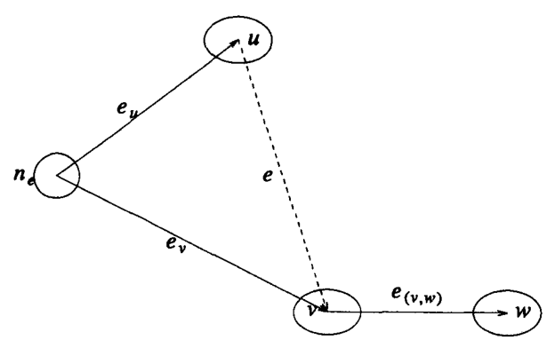

**図13　補助グラフ。**

ここで、$G'$ 上の階層割当て問題を考えることができ、これはネットワーク単体法で解ける。$G$ 上の配置問題のどの解にも、同じ費用を持つ $G'$ 上の階層割当て問題の解が対応する。図13の記号を使い、$x_u$ と $x_v$ を $G$ で $u$ と $v$ に割り当てられた $X$ 座標とすると、これは各 $n_e$ に値 $\min(x_u,x_v)$ を割り当てることで実現できる。逆に、$G'$ の任意の階層割当ては、$G$ の有効な配置を誘導する。さらに、最適な階層割当てでは、$e_u$ と $e_v$ の一方の長さは0でなければならず、他方の長さは $|x_v-x_u|$ になる。これは、$G$ の元の辺 $(u,v)$ の費用が、$G'$ の2本の辺 $e_u,e_v$ の費用の和に等しく、全体として2つの解が同じ費用を持つことを意味する。したがって、$G'$ の最適性は $G$ の最適性を意味し、$G'$ を解くことで $G$ の解が得られる。

補助グラフの利用は、「ノードポート」、すなわちノード中心から $X$ 方向にずれた辺の端点の指定も可能にする。これにより、図14のような平坦なレコードの図を描ける。このような図のノード座標を計算するときには、辺長に、ノードの中心点間の距離だけでなく、ノードポートの変位も含めなければならない。$e=(u,v)$ を辺とし、$\Delta_u$ と $\Delta_v$ を、それぞれ $u$ と $v$ の中心から端点までの、指定された $X$ 方向の変位とする。$\Delta<0$ は、ポートが頂点中心の左側にあることを示す。一般性を失うことなく $\Delta_u\leq\Delta_v$ と仮定し、$d_e=\Delta_v-\Delta_u$ とする。$d_e$ は、ノードポートだけに依存し、$u$ と $v$ への割当てには依存しないため、定数である。これで同じ最適化問題を解くことができるが、辺 $e$ の費用は $\Omega(e)\omega(e)|x_v-x_u+d_e|$ で与えられる。補助グラフでは、$\delta(e_u)=d_e$、$\delta(e_v)=0$ と設定する。そこで、先ほどの議論を拡張すると、$G$ の任意の配置が $G'$ の階層割当てに対応すること、$G'$ の任意の最適な階層割当てが $G$ の有効な配置を誘導すること、そしていずれの場合も、$G$ のすべての辺 $(u,v)$ について

$$
l(e_u)+l(e_v)=|x_v-x_u+d_e|+d_e
$$

が成り立つことを示せる。ここで $l$ は、$G'$ 上の階層割当てにおける長さ関数を表す。この式は、$G$ と $G'$ の問題の最適費用が、常に定数 $\sum_{e\in E}d_e$ だけ異なることを意味する。したがって、$G'$ の最小割当ては、$G$ の最小割当てに対応する。[^port-cost]

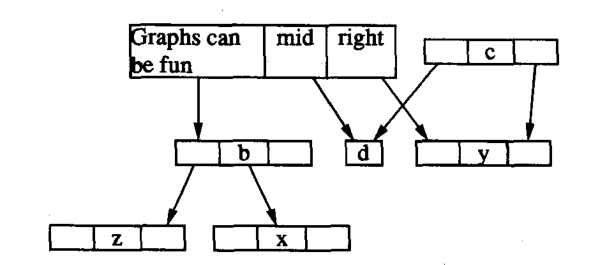

**図14　グラフのノードポート。**

図中の文字列 `Graphs can be fun` は「グラフは楽しい」、`mid` は「中央」、`right` は「右」を意味する。これらはレコードのフィールド文字列として原図のまま収録した。

図15(a)は、補助グラフの辺の $\delta$ 値へ、ポートのオフセットをどう変換するかの例を示す。図15(b)は、解が元の辺とどのように対応するかを示す。

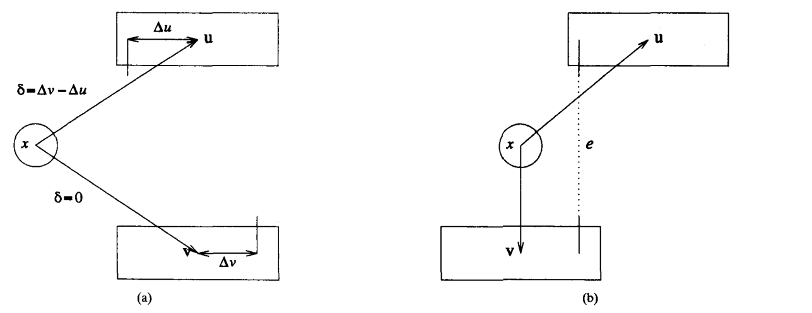

**図15　ポートのオフセットを $\delta$ 値へ変換する方法。**

### C. 実装の詳細の再検討

補助グラフは元のグラフよりもかなり大きい。元のグラフが $V$ 個のノード、$E$ 本の辺、$R$ 個の階層を持つとすると、「仮想」ノードを加えたグラフは $V+D$ 個のノードと $E+D$ 本の辺を持つ。ここで、$D$ は「仮想ノード」の数である。すると、補助グラフは $V+E+2D$ 個のノードと $V+2E+3D-R$ 本の辺を持つ。このグラフでネットワーク単体法によるアプローチを使うには、大きさの増加に見合う以上の時間が必要になる。そのため、第II節末尾で述べたネットワーク単体法の最適化は、このパスで不可欠である。

補助グラフの構造を利用すれば、最初の実行可能木を容易に構築できることに着目すると、さらに改善できる。実行可能木の構築には、同じ階層のノードを結ぶすべての辺を用いる。隣接階層の各対について、それらを結ぶ辺 $f=(u,v)$ を1本選び、$G'$ の $f_u$ と $f_v$ の両方を木に加える。これにより、その2つの階層のすべてのノードの相対配置が定まる。最後に、2つの階層間の各辺 $e=(w,x)\neq f$ について、$w$ と $x$ のどちらが左側に配置されているかに応じて、$e_w$ または $e_x$ を木に加える。

これらの改善がない場合、ネットワーク単体法によるノード配置には5–10倍長い時間がかかった。改善を加えると、我々の実装はヒューリスティックな実装と同等か、それ以上に速く動作する。ヒューリスティクスの側もさらに調整できることは疑わないが、本当の利点は、ネットワーク単体法のコードがはるかに簡単であり、最適解を生成することである。また、ヒューリスティクスに組み込むことが難しい改善も、ネットワーク単体法では扱える。たとえば、ネットワーク単体法の終了後にグラフを走査して、局所的な対称性（A4）を改善できる。カット値が正確に0である木辺は、解の費用を変えずに、接続する辺のスラックを等しくするよう調整できる部分グラフを示す。これは、子孫が偶数個あるノードを中央に置くなど、対称性を高めるために使える。

## V. 辺の描画

我々の方法では、辺をスプライン曲線として描く。我々が知る他のグラフ描画プログラムは線分を用いており、その大部分は、線分が無関係なノードと重なる状況を避けようとしない。スプラインはプログラムするのが難しいが、より良い描画を生み、美的基準A2を満たす助けとなる。

`dag` では、[1] に述べられているように、仮想ノード間を結ぶ線分の経路をさまざまな直線部分や曲線部分に置き換える、一群のヒューリスティクスによって辺のスプラインを作る。欠点は、スプラインが、仮想ノードの矩形内で方向を変えたり、近くのノードを避けたりするために、急激に曲がることがある点である。結果として、最終レイアウトで仮想ノードの存在が見えてしまう。この方法は、利用できる空間を有効に使わない。

他のノードやスプラインという「障害物」を避ける、2点間の最も滑らかな曲線を求めようとするほうがよい。そこで、スプラインの経路決定アルゴリズムを上位部分と下位部分に分けることができる。上位部分は、スプラインを描けるレイアウト内の多角形領域を計算する。そして、その領域内で最良のスプラインを計算するために下位部分を呼び出す。最後に、上位部分はスプラインの外接矩形に従って仮想ノードの大きさを変更し、端点ノードの形状の境界でスプラインを切り詰める。

領域とそのスプラインを図16に示す。[^graph-data] 対応する辺は「Interdata」から「Unix TS 3.0」への辺である。より形式的には、次の部分問題のインスタンスを作って解くことにより、スプラインを描く。$B_0,\ldots,B_m,q,\theta_q,r,\theta_r$ が与えられており、$B_i$ は座標軸に平行な矩形で、$B_i$ は $B_{i-1}$ および $B_{i+1}$ と辺を共有し、$q$ と $r$ はそれぞれ最初と最後の矩形の内部または境界上の点であるとする。このとき、$s_0,\ldots,s_n$ および $BB_0,\ldots,BB_m$ を求める。ただし、$s_i$ は区分ベジエ曲線の制御点であり、$BB_i$ は座標軸に平行な矩形である。曲線は $q$ と $r$ を端点として持たなければならない。$\theta_q$ と $\theta_r$ は省略可能である。指定された場合、曲線は対応する端点で指定された傾きを持たなければならない。$BB_i$ は $B_i$ に対応し、生成したスプラインを含む最小の矩形である。

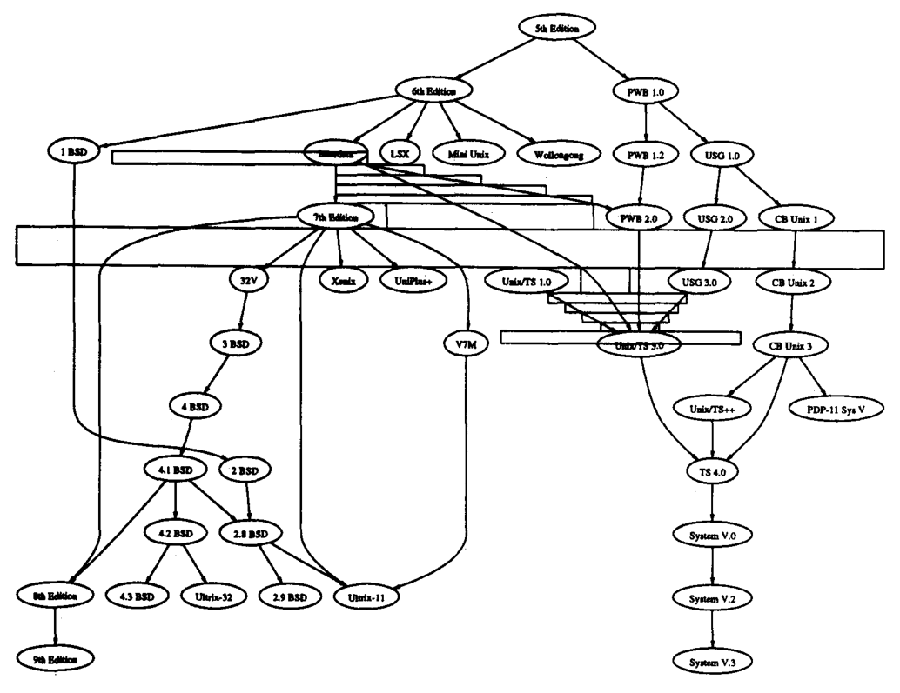

**図16　スプラインの領域（Sun-4/280でのユーザーCPU時間は0.48秒）。**

以下では、アルゴリズムの2つの部分を述べる。

### A. 領域の探索

描画には、異なる階層のノード間の辺、同じ階層にある異なるノード間の水平辺、および自己辺すなわちループという、3種類の辺がある。

**異なる階層の場合**：実際には、ほとんどの辺が異なる階層のノードを結ぶ。この種の辺の領域は、始点ポート付近のいくつかの矩形、階層間の矩形と仮想ノードの矩形が交互に現れる列、そして最後に終点ポート付近のいくつかの矩形からなる。始点ポートと終点ポートの矩形は、ノードの適切な側へスプラインを導く。

できるだけ滑らかに曲がれるようにするため、スプラインには利用できるすべての空間を使わせるべきである。したがって、領域には仮想ノードの矩形だけでなく、その隣の余分な空間も含めるべきである。スプラインを計算した後、$BB_i$ に従って仮想ノードの矩形を更新する。これにより、後で計算するスプラインは、残ったすべての空間を使いながら、すでに描かれたスプラインに近づきすぎずに済む。スプラインは「貪欲」な方針で描かれるので、計算する順序に依存する。短いスプラインは直線として描けることが多いため、先に経路を決定するのが妥当に思われるが、順序は描画の品質にそれほど影響しないようである。

スプラインの見た目を改善するのに役立つ、3つの詳細がある。第1に、辺が交差する場合、互いを過度に制約すべきではない。そうしないと、スプラインが不自然に急旋回することがある。これは矩形を調整することで容易に避けられる。矩形の大きさを定めるとき、2階層以内で交差する辺に対応する、左または右の仮想ノードを無視する。それより遠くの交差は考慮しない。矩形の制約を緩めすぎると、意図しない複数の交差が起こり得るからである。

第2に、辺がほぼ垂直な部分を持つ場合、その部分は単に垂直線として描くほうがよく見える。辺同士が並んで走る場合にこれは最も明らかである。傾きがわずかに異なる長い線分よりも、平行な線分のほうがよく見えるからである。領域探索の手続きが長い垂直部分を検出すると、現在の領域を終了してそのスプラインを描き、垂直線分を描いた後、辺の残りの部分の領域を開始する。これは $\theta_q$ と $\theta_r$ を使う状況の1つである。垂直線分に接続する端点で、スプラインが垂直接線を持たなければならないからである。

第3に、複数のスプラインが共通の終端点へ近づくとき、「偶発的な」交差を避けることが重要である。このため、同じ端点を持つ、すでに計算されたスプラインがあるかを調べる。ある場合は、右側と左側で最も近いものを求める。次に、階層間の空間を細分し、それぞれの区切りで左右のスプラインを評価する。これらの点（左右いずれかのスプラインが存在しない場合は、レイアウトの境界）により、終端ノードに近づく際に、新しいスプラインを既存のものから隔てる矩形の集合が定まる。左右のスプラインと、その結果得られる矩形は図16に見られる。この階層間矩形の細分は、必ずしも座標軸に沿っていない多角形領域を近似していると見なせる。レイアウトによっては、軸に沿っていない矩形や他の多角形によって、意図しない接触を防げる箇所が他にもある。このプログラムをもう一度書くならば、矩形ではなく一般の多角形を試すだろう。

ここまでは、同じノード対の間の多重辺について述べていなかった。これらがある場合は、辺の1本についてスプラインを計算し、残りの辺は、それぞれに次第に大きくなる $X$ 座標の変位を加えて描く（$nodesep(G)$ の倍数を使うとよい）。多重辺のための空間は、第IV節で述べた前のパスにおいて、ノード間隔を設定するときに確保しなければならない。

**水平辺の場合**：水平辺は階層間の辺とほぼ同様に扱うが、領域は途中のノードとノード間の空間を通り過ぎるように経路を取る。よく似ているため、詳細の大部分は省略する。違いの1つは、辺が隣接する2つのノードを結ぶ場合、次の制御点を持つ単一のスプラインとして描くことである。

$$
\begin{aligned}
dx&=x(u)-x(v)\\
p_0&=(x(v),y(v))\\
p_1&=p_0+\left(\tfrac13dx,0\right)\\
p_2&=p_0+\left(\tfrac23dx,0\right)\\
p_3&=(x(u),y(u)).
\end{aligned}
$$

水平辺が複数ある場合は、最初の1本についてスプラインを計算し、後続の辺は $Y$ 座標の変位を加えて描く。辺にラベルがある場合は、辺の途中の中間位置にラベルを置く。

**自己辺の場合**：自己辺は、ノードの側面にループとして描く。辺に始点ポートまたは終点ポートが指定されている場合は、2つのポートを結ぶ多角形領域を生成する。領域の向きは、ポートの位置に応じて時計回りにも反時計回りにもなる。辺に始点ポートと終点ポートが指定されていない場合は、$p_0,\ldots,p_3$ と $p_3,\ldots,p_6$ という、2つのスプラインの列として描く。これらの制御点は次のように計算する。

$$
\begin{aligned}
dx&=nodesep(G)\\
dy&=\tfrac12ysize(v)\\
p_0&=(x(v),y(v))\\
p_1&=p_0+\left(\tfrac13dx,dy\right)\\
p_2&=p_0+\left(\tfrac23dx,dy\right)\\
p_3&=p_0+(dx,0)\\
p_4&=p_0+\left(\tfrac23dx,-dy\right)\\
p_5&=p_0+\left(\tfrac13dx,-dy\right)\\
p_6&=p_0.
\end{aligned}
$$

複数の辺がある場合、そのループは入れ子にする。辺にラベルがある場合は、辺の途中の中間位置にラベルを置く。上記の単純な場合では、ラベルは点 $p_3$ の右側に置く。ラベル付きの多重辺の場合は、辺間の変位にラベルの大きさを加える。これにより、ある辺の曲線が別の辺のラベル上を横切ることを防ぐ。自己辺のための空間は、第IV節で述べた前のパスにおいて、隣接ノード間の間隔を設定するときに割り当てる。

### B. スプラインの計算

スプラインの計算には3つの段階がある。まず、領域の内部に完全に含まれる区分線形曲線、すなわち経路を計算する。次に、この経路の端点を、区分ベジエスプラインの計算における手がかりとして用いる。最後に、曲線が実際に使う空間を、元の矩形を用いて計算する。これら3段階で計算するデータ構造を図19に示す。この図の領域は図16と同じものである。この例は13個の矩形を含む。

3段階の概略を図17に示す。

```text
 1. procedure compute_splines (B_array, q, theta_q, use_theta_q,
                              s, theta_s, use_theta_s)
 2.     compute_L_array (B_array);
 3.     compute_p_array (B_array, L_array, q, s);
 4.     if use_theta_q then vector_q = anglevector(theta_q)
 5.     else vector_q = zero_vector;
 6.     if use_theta_s then vector_s = anglevector(theta_s)
 7.     else vector_s = zero_vector;
 8.     compute_s_array (B_array, L_array, p_array, vector_q, vector_s);
 9.     compute_bboxes ();
10. end
```

**図17　スプラインの計算。**

**図17に関する説明**

- **2**：`compute_L_array` は配列 $L_0,\ldots,L_{m+1}$ を計算する。$L_i$ は、矩形 $B_{i-1}$ と矩形 $B_i$ の共通部分である線分である。図19では、これらの線分は矩形間の太い線として示されている。このような線分は14本ある。
- **3**：`compute_p_array` は、$q$ と $s$ を結ぶ実行可能な経路を定める点の配列 $p_0,\ldots,p_k$ を計算する。図19では、そのような点は3つある。
- **4–7**：`use_theta_q` または `use_theta_s` が真の場合、曲線は、指定された角度で対応する端点へ近づくように制約される。`vector_q` と `vector_s` は正規化されたベクトルである。
- **8**：`compute_s_array` は、$q$ と $s$ を結び、完全に領域内に収まる区分ベジエスプラインを定める、点の配列 $s_0,\ldots,s_k$ を計算する。最悪の場合、矩形ごとに1つのベジエスプラインが生じ得る。しかし、ほとんどの場合、我々のアプローチははるかに少ないスプラインを生成する。たとえば、図19では、$p_0$ と $p_1$ の間、および $p_1$ と $p_2$ の間という、2つのスプラインしかない。より複雑な経路では、直線と異なり、スプラインは障害物の周囲で曲がれるため、スプラインの数が線分数より少なくなることさえある。
- **9**：`compute_bboxes` は、曲線が実際に占める空間を計算する。配列 $BB_0,\ldots,BB_m$ を計算し、$BB_i$ は、曲線を含む $B_i$ の最も狭い部分矩形である。

`compute_p_array` と `compute_s_array` は、いずれも図18に示すような分割統治法として実装する。

```text
 1. procedure compute_p_array (B_array, L_array, q, s)
 2.     if line_fits (B_array, L_array, q, s) then return;
 3.     p = compute_linesplit (B_array, L_array);
 4.     addto_p_array (p);
 5.     compute_p_array (B_array1, L_array1, q, p);
 6.     compute_p_array (B_array2, L_array2, p, s);
 7. end
 8.
 9. procedure compute_s_array (B_array, L_array, p_array, vector_q, vector_s)
10.     spline = generate_spline (p_array, vector_q, vector_s);
11.     if size (p_array) == 2 then
12.         while spline_fits (spline, B_array, L_array) == False do
13.             straighten_spline (spline);
14.     elseif spline_fits (spline, B_array, L_array) == False then
15.         count = 0;
16.         ospline = spline;
17.         repeat
18.             spline = refine_spline (p_array, ospline,
19.                                     mode (count, max_iterations));
20.             fits = spline_fits (spline, B_array, L_array);
21.             count = count + 1;
22.         while (fits == False) and (count <= max_iterations);
23.         if fits == False then
24.             p = compute_splinesplit (spline, p_array);
25.             compute_s_array (B_array1, L_array1, p_array1,
26.                              vector_q, vector_p);
27.             compute_s_array (B_array2, L_array2, p_array2,
28.                              reverse (vector_p), vector_s);
29.             return;
30.         endif
31.     endif
32.     addto_s_array (spline);
33. end
```

**図18　スプラインの描画。**

**図18に関する説明**

- **2**：`line_fits` は、$q$ と $s$ によって定まる直線が、完全に実行可能領域の内部にあるかを調べる。直線を各矩形で切り詰める。直線が矩形と交わる場合、それは対応する $L$ 線分上でなければならない。
- **3**：$(q,s)$ の直線が収まらない場合、`compute_linesplit` は、$(q,s)$ の直線から最も遠い $L$ 線分を求め、その線分に沿って `B_array` と `L_array` を細分する。$p$ は、その分割線分の2つの端点のうち、$(q,s)$ の直線に近いほうである。たとえば図19では、経路は $L_7$ に沿って分割される。
- **4**：`addto_p_array` は、経路の端点配列に $p$ を加える。
- **5–6**：`compute_p_array` の2つの再帰呼出しによって、経路の計算が完了する。`compute_p_array` が最短経路を生成することは保証されないが、非常によく機能するので、我々はそれ以上の改良を行っていない。重要であれば、凸包を用いて最短経路を線形時間で求めることができる [18]。
- **10**：`generate_spline` は、経路を近似するベジエスプラインを計算する。これは一般的な手法 [19] を用いて行う。
- **11–13**：まず、経路に線分が1つだけある場合を扱う。`spline_fits` は、スプラインが完全に領域内に収まるかを調べる。スプラインをその長さに沿って標本化し、これらの標本を線形経路として矩形領域で切り詰める。この処理は `line_fits` と似ている。スプラインが収まらない限り、`straighten_spline` が制御点を調整して曲率を減らす。最悪の場合、スプラインは直線になるが、この直線が経路内に収まることは分かっている。この最悪の場合は、急な屈曲を生むことがある。しかし、大部分の場合、スプラインはわずか数回の反復後に領域内に収まり、この処理は視覚的な不自然さを生まない。最悪の場合が起こり得るのは、領域自体が急に曲がっているときだけである。
- **14–30**：第2の場合は、経路が複数の線分を持つ場合である。スプラインが収まらない場合、`refine_spline` は、スプラインを収めようとして制御点を摂動させる。このアプローチは、11–13行目の直線化のアプローチと似ている。まずスプラインの曲率を減らそうとする。それで収まり方が改善しないようなら、曲率を増やそうとする。この処理は終了しない可能性があるため、`max_iterations` で試行回数を制御する。`mode` は、曲率を増やすか減らすかを示すフラグを返す。調整してもなおスプラインが収まらない場合、問題を細分する。`compute_splinesplit` は、経路上の線分の端点のうち、スプラインから最も遠いものを求め、その点に沿って矩形配列と経路配列を細分する。`compute_s_array` の2つの再帰呼出しは、それぞれ対応する領域部分に収まる2つの区分ベジエスプラインを計算する。2つの曲線を分割点で滑らかに接続させるため、そこで2つのスプラインが同じ単位接線ベクトルを持つことも強制する。これにより、分割点における $C^1$ 連続性が保証される。$C^2$ 連続性を強制しても、より良い結果が得られるとは思われず、計算費用もはるかに大きい。多くの時間を節約する直線化と調整のヒューリスティクスは、スプライン端点の接線ベクトルを、隣接する2つのスプラインの接線ベクトルとは独立にスケーリングできるという仮定に基づいている。$C^2$ 連続性を維持するには、接線ベクトルをスケーリングするたびに、2つのベクトルが同じ長さを保つよう、隣接スプラインの接線ベクトルもスケーリングしなければならない。このスケーリングは、領域の端まで伝播することがある。さらに、これらのスプラインのいくつかは、スケーリング後でも収まらず、単一の矩形内での分割も含めて、さらなる細分が必要になるかもしれない。これは、得られる利点に比べて手間がかかりすぎる。
- **32**：最後に、`addto_s_array` が、区分ベジエスプラインにそのスプラインを加える。

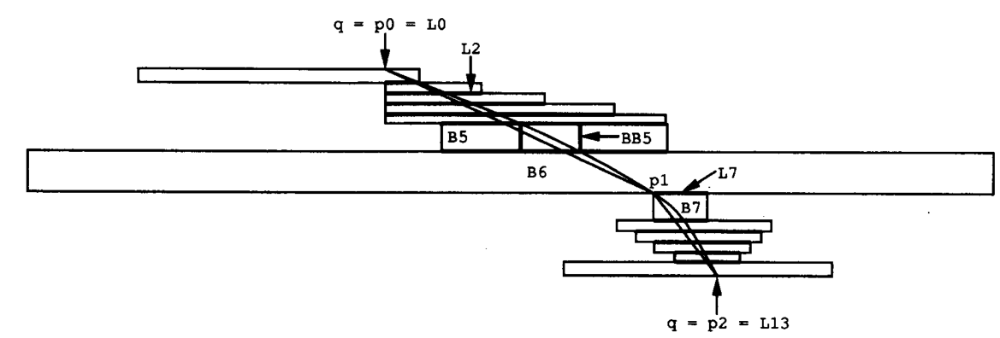

**図19　3つの段階。**

### C. 辺のラベル

`dag` では、辺のラベルをスプラインの中点の隣に置く。この配置は、他のスプライン、ラベル、ノードとの重なりを避けることも、検出することさえもしないため、単純化しすぎている。それでも、辺ラベルを持つグラフは小さく疎なことが多いので、この手法が十分である場合もある。

`dot` では、階層間の辺のラベルを、中心からずらした仮想ノードとして表す。これにより、ラベルが他のノード、辺、ラベルと重ならないことが保証される。ラベルの追加が辺長に影響しないようにするには、いくつかの調整が必要である。辺の最小長を2に設定し（仮想ノードを作るときに、実質的に階層数を2倍にする）、階層間隔を半分にすることで、ラベルノードの影響を補償する。これにより、ラベル付きグラフの描画には少なくとも2倍の費用がかかるが、ラベルは読めるものになる。図20は、辺ラベル付きグラフの描画を示す。

自己辺のラベルは容易に扱えるが、水平辺はより複雑である。この場合、ラベルの仮想ノードの $X$ 座標が、端点座標の右や左ではなく、その間に来るように、左から右への順序を選ばなければならない。現在、この問題については引き続き取り組んでいる。

図（地理的な地図など）における、より洗練されたラベル配置は、さらなる研究に値する難しい研究課題である。ただし、FreemanとAhn [20] が述べたラベル配置プログラムは、我々のグラフ描画プログラム全体よりも大きいことには触れておく価値がある。

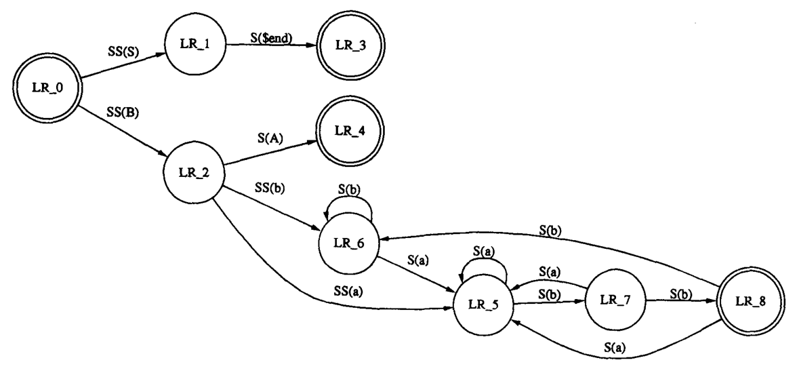

**図20　ラベル付き遷移を持つ有限状態機械（Sun-4/280でのユーザーCPU時間は0.15秒）。**

## VI. 結論

我々は、有向グラフを描画するための一手法を述べた。我々の貢献は、階層と最終的なノード座標の割当てへのネットワーク単体法の適用、辺交差を減らすための改善されたヒューリスティクス、および辺のスプラインを作る方法である。ノード座標を求める方法は、端点に $X$ 座標方向の変位を持つ辺を扱える。これらの手法はプログラムしやすく、対話的な利用に十分な速さで動作し、読みやすさと視覚的な好ましさの点で、従来の研究に十分匹敵する描画を生成する。

今後の研究では、次の事項を扱うことが考えられる。

- 読みやすさを高めるために、グラフまたはそのレイアウトをどのように修正すべきかを理解する。
- 辺交差とスプライン描画のヒューリスティクスを改善する。
- レイアウトのパス間で、より多くの相互作用を可能にする。ある段階で同じ費用を持つ異なる解が、後続段階の結果に大きく影響することがある。たとえば、2つのレイアウトが同じ交差数を持っていても、最終的な座標は大きく異なり得る。
- アニメーションのための増分的な（オンラインの）グラフ描画を支援する。ある描画から次の描画への安定性が不可欠である。

## 謝辞

査読者からの詳細なコメントは、特に第II節において、説明を明確にする助けとなった。また、内容と文体に関する批評を寄せてくれたG. JacobsonとS. Lallyにも感謝する。

## 参考文献

原論文の書誌情報を保持し、各題名の日本語訳を括弧内に併記する。巻号・年などは、原論文に記載された値のままとする。

[1] E. R. Gansner, S. C. North, and K.-P. Vo, “DAG—A program that draws directed graphs” （DAG――有向グラフを描画するプログラム）, _Software—Practice and Experience_, vol. 17, no. 1, pp. 1047–1062, 1988.

[2] P. Eades and R. Tamassia, “Algorithms for automatic graph drawing: an annotated bibliography” （自動グラフ描画のアルゴリズム：注釈付き文献一覧）, Tech. Rep. CS-89-09 (Revised Version), Brown University, Department of Computer Science, Providence RI, Oct. 1989.

[3] J. Warfield, “Crossing theory and hierarchy mapping” （交差理論と階層写像）, _IEEE Trans. Syst. Man Cybern._, vol. SMC-7, no. 7, pp. 505–523, July 1977.

[4] M. Carpano, “Automatic display of hierarchized graphs for computer aided decision analysis” （コンピュータ支援意思決定分析のための階層化グラフの自動表示）, _IEEE Trans. Software Eng._, vol. SE-12, no. 4, pp. 538–546, 1980.

[5] K. S. Sugiyama, S. Tagawa, and M. Toda, “Methods for visual understanding of hierarchical system structures” （階層的システム構造の視覚的理解のための方法）, _IEEE Trans. Syst. Man, Cybern._, vol. SMC-11, no. 2, pp. 109–125, Feb. 1981.

[6] G. Di Battista and R. Tamassia, “Algorithms for plane representations of acyclic digraphs” （非巡回有向グラフの平面表現のためのアルゴリズム）, _Theoretical Computer Sci._, vol. 61, pp. 175–198, 1988.

[7] E. Koutsofios and S. North, “Drawing graphs with dot” （dotによるグラフ描画）, Tech. Rep. (available from the authors／著者から入手可能), AT&T Bell Laboratories, Murray Hill NJ, 1992.

[8] L. A. Rowe, M. Davis, E. Messinger, C. Meyer, C. Spirakis, and A. Tuan, “A browser for directed graphs” （有向グラフのためのブラウザ）, _Software—Practice and Experience_, vol. 17, no. 1, pp. 61–76, Jan. 1987.

[9] A. Aho, J. Hopcroft, and J. Ullman, _The Design and Analysis of Computer Algorithms_ （コンピュータアルゴリズムの設計と解析）. Reading, MA: Addison-Wesley, 1974.

[10] P. Eades, B. McKay, and N. Wormald, “On an edge crossing problem” （ある辺交差問題について）, in _Proc. 9th Australian Computer Science Conf._, 1986, pp. 327–334.

[11] R. Garey and D. S. Johnson, _Computers and Intractability_ （コンピュータと計算困難性）. San Francisco: W. H. Freeman, 1979.

[12] G. Robbins, “The ISI grapher, a portable tool for displaying graphs pictorially” （ISI grapher：グラフを図として表示する移植可能なツール）, _Symboliikka ’87_, Helsinki, Finland, also Tech. Rep. IST/RS-87-196, Information Sciences Institute, Marina Del Rey, CA.

[13] A. V. Goldberg and R. E. Tarjan, “Finding minimum-cost circulations by successive approximation” （逐次近似による最小費用循環流の探索）, _Mathematics of Operations Res._, vol. 15, no. 3, pp. 430–466, 1990.

[14] E. R. Gansner, S. C. North, and K.-P. Vo, “On the rank assignment problem” （階層割当て問題について）, to be submitted（投稿予定）.

[15] V. Chvátal, _Linear Programming_ （線形計画法）. New York: W. H. Freeman, 1983.

[16] W. H. Cunningham, “A network simplex method” （ネットワーク単体法の一手法）, _Mathematical Programming_, vol. 11, pp. 105–116, 1976.

[17] P. Eades and N. Wormald, “The median heuristic for drawing 2-layers networks” （2階層ネットワーク描画のための中央値ヒューリスティクス）, Tech. Rep. 69, Dept. of Computer Science, University of Queensland, 1986.

[18] S. Suri, “A linear time algorithm for minimum link paths inside a simple polygon” （単純多角形内の最小リンク経路のための線形時間アルゴリズム）, _Computer Vision, Graphics, and Image Processing_, vol. 35, pp. 99–110, 1986.

[19] A. S. Glassner, Ed., _Graphics Gems_ （グラフィックスの珠玉の技法）. San Diego: Academic Press, 1990.

[20] H. Freeman and J. Ahn, “On the problem of placing names in a geographic map” （地理的な地図への名称配置の問題について）, _Int. J. Pattern Recognition and Artificial Intell._, vol. 1, no. 1, pp. 121–140, 1987.

## 著者略歴

**Emden R. Gansner**は、1980年にマサチューセッツ州ケンブリッジのマサチューセッツ工科大学で数学の博士号を取得した。

イリノイ大学アーバナ校で教えた後、1980年にAT&T Bell Labsに入社し、現在はDistinguished Member of the Technical Staffである。研究上の関心には、グラフィカルユーザーインターフェース、プログラミング環境、プログラミング言語、グラフが含まれる。

**Eleftherios Koutsofios**は、ギリシャのアテネにあるNational Technical Universityで電気工学のDiplomaを取得し、ニュージャージー州プリンストンのプリンストン大学で計算機科学の修士号および博士号を取得した。

1990年にMember of the Technical StaffとしてAT&T Bell Labsに入社した。研究上の関心は、対話的手法、アルゴリズムのアニメーション、計算幾何学の分野にある。制約に基づく描画システム、プログラム可能なグラフィックスエディタ、および科学的可視化のためのツールに取り組んできた。

**Stephen C. North**は、ニュージャージー州プリンストンのプリンストン大学で、1983年と1986年にそれぞれ計算機科学の修士号および博士号を取得した。

1980年以来、AT&T Bell LabsのMember of the Technical Staffである。現在の研究上の関心には、グラフレイアウトのプログラムとアルゴリズム、および対話的なプログラミング環境が含まれる。

**Kiem-Phong Vo**は、カリフォルニア大学サンディエゴ校で、1977年と1981年に数学の修士号および博士号を取得した。

1981年以来、AT&T Bell Laboratoriesに所属し、現在はDistinguished Member of the Technical Staffである。研究上の関心には、グラフ理論、データ構造とアルゴリズム、ユーザーインターフェース、およびソフトウェアツールが含まれる。最新のSystem Vの `malloc` メモリ割当てパッケージ、画面管理用の `curses` ライブラリ、メニューとフォームのインターフェースを持つアプリケーションを構築するための言語IFSなど、複数のUNIXツールを単独または共同で作成した。

Vo博士は、1992年にAT&T Bell Labs Fellowに選出された。

## 原文の脚注・出版注記

原稿受理：1991年8月26日。改訂：1992年5月22日。Helmut Partschによる推薦。

著者らの所属：AT&T Bell Laboratories, Murray Hill, NJ 07974。

IEEEログ番号：9206903。

出版識別・著作権表記：0098-5589/93 $03.00、© 1993 IEEE。

添付PDFの各ページに付された利用表示：許諾されたライセンスによる利用はNIHON UNIVERSITYに限定される。2026年5月12日23:10:35 UTCにIEEE Xploreからダウンロード。利用制限が適用される。

[^graph-data]: 原文脚注1：グラフデータは、SoftQuad Inc.のIan F. Darwin、およびSoftware Tool & DieのGeoffrey Collyerの厚意による。

## 訳注

[^port-cost]: 第IV節Bの「定数 $\sum_{e\in E}d_e$」は、原文の記述をそのまま訳した。直前で定義された重み付き費用を用いる場合、費用差には各辺の重み $\Omega(e)\omega(e)$ も掛かるため、一般には $\sum_{e\in E}\Omega(e)\omega(e)d_e$ となる。本文の式・記述は改変していない。

著者略歴中の「現在」および本文中の「今後」「投稿予定」などは、原論文の執筆・刊行時点を指す。図3(a)の原キャプションにある「0.50 s」の重複は、日本語では1回だけ表記した。擬似コード中の省略記号は原文にあるものを保持しており、訳者による省略ではない。
